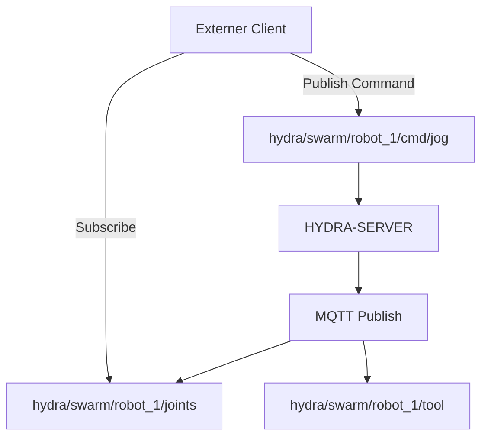

<!-- =============================================================================
HYDRA-UMC-MQTT-BROKER - MQTT broker for telemetry and integrations
Copyright (C) JuanenRac (Electro Hobby 3D) <electrohobby3d@gmail.com>
GPL-3.0-or-later - see LICENSE
============================================================================= -->

<p align="center">
  
</p>

# 📡 HYDRA-UMC-MQTT-BROKER

<p align="center"><a href="README.md">🇺🇸 English</a> | <a href="README_spa.md">🇪🇸 Español</a> | <a href="README_fra.md">🇫🇷 Français</a> | <a href="README_ita.md">🇮🇹 Italiano</a> | 🇩🇪 <b>Deutsch</b> | <a href="README_zho.md">🇨🇳 简体中文</a> | <a href="README_jpn.md">🇯🇵 日本語</a> | <a href="README_por.md">🇵🇹 Português</a></p>

### 🚀 Leichtgewichtige Telemetrie-Brücke für IoT und externe Integrationen

<p align="center">
  
  
  
  
  
  
</p>

---

**Ehrlichkeitscheck - was heute wirklich läuft:** der Broker-Transport (`src/server.ts`), die Topic-ACL (`src/acl.ts`) und die CONNECT-Authentifizierung (`src/auth.ts`) sind real und getestet (163 bestandene Tests in 12 Dateien), und `tsc --noEmit` ist sauber. Das sind keine isolierten Unit-Tests gegen simulierte Interna - `tests/server.test.ts` verbindet eine echte `mqtt`-Client-Bibliothek über einen echten TCP-Socket mit einem echten laufenden Aedes-Broker, und genau so wurde ein echter Bug tatsächlich gefunden (der übersprungene `broker.listen()`-Schritt von Aedes 1.x, der jedes CONNECT stillschweigend hängen ließ). Der MQTT-über-WebSocket-Listener und die Payload-Größenbegrenzung funktionieren genauso: real, optional und broker-getestet. Was tatsächlich nicht gebaut ist: mDNS-/Home-Assistant-Discovery ist nur geplant - `server.ts` ist ein reiner TCP-Listener ohne jeglichen Discovery-Dienst - und die `hydra/swarm/...`-Topic-Form im Diagramm weiter unten ist die beabsichtigte zukünftige Form, sobald der eigene Zustand von HYDRA-UMC-SERVER an MQTT angebunden wird, was noch nicht geschehen ist; nur die `hydra/bridges/<name>/...`-Topics der 5 externen Maschinen-Bridges sind heute real und verdrahtet. Siehe `CHANGELOG.md` für das, was bisher genau ausgeliefert wurde.

---

> **Stand von Sicherheit (Safety) und Security:** Dieses Ökosystem ist kein zertifiziertes Sicherheitssystem. Es gibt noch keinen Hardware-E-STOP-Pfad, keine von der Firmware durchgesetzten Grenzen oder Verriegelungen und keinen verifizierten Bewegungsbefehl; Firmware-Images werden mit CRC-32 und einer Ed25519-Signatur geprüft, und ein Release-Build verweigert die veröffentlichten Entwicklungsschlüssel (die Werkzeugköpfe und Erweiterungsplatinen hinter dem Relais laufen noch mit URTC-Bootloadern, die statt einer Signatur ein HMAC-SHA256 mit gemeinsamem Schlüssel verwenden); TLS und gegenseitiges TLS sind optional und standardmäßig aus; noch keine eigene Platine wurde bestückt oder getestet. Lesen Sie die [Sicherheitsbasis](https://github.com/JuanenRac/HYDRA-UMC-DOCS/blob/main/docs/SECURITY_BASELINE.md) und das [Bedrohungsmodell](https://github.com/JuanenRac/HYDRA-UMC-DOCS/blob/main/docs/THREAT_MODEL.md), bevor Sie sich für die Sicherheit einer Person auf eine Aussage hier verlassen.

---

## 📋 Auf einen Blick

| | |
|---|---|
| Version | `0.1.7` |
| Reifegrad | Funktionsfähig |
| Tests | 163 (`npm test`) |
| Technik | Node.js / TypeScript / Aedes MQTT broker (MQTT 3.1.1) / MQTT over WebSockets (ws) / TLS and mutual TLS (optional) |
| Ziel | Der Raspberry Pi CM5 einer HYDRA-UMC-Zelle |
| Auf echter Hardware | Noch nicht: für diese Version ist kein Lauf auf echter Hardware vermerkt |

**Springe zu:** [Überblick](#-überblick) · [Architektur](#-architektur) · [Konfiguration](#-konfiguration) · [Schnellstart](#-schnellstart) · [Tests](#-tests) · [Struktur des Repositorys](#-struktur-des-repositorys) · [Verwandte Projekte](#-verwandte-projekte)

## 🚦 Projektstatus

Jede Zeile ist ein Teil dieses Repositorys, und die Ampel sagt, wie weit er heute ist. Sie beruht auf dem, was das Repository zeigen kann (Tests, Builds, Läufe), nicht auf dem, was geplant ist.

🟢 Fertig und überprüft · 🟡 Funktioniert, mit bekannten Grenzen · 🟠 Teilweise fertig oder noch nicht überprüft · 🔴 Nicht gemacht oder funktioniert nicht

| Bereich | Stand | Was das hier bedeutet |
|---|---|---|
| Software | 🟡 | Funktioniert für seinen Hauptzweck; die Ehrlichkeitsprüfung oben nennt, was noch fehlt |
| Tests | 🟢 | 163 automatische Tests, bei jeder Änderung ausgeführt |
| Echte Hardware | 🔴 | Noch nicht: für diese Version ist kein Lauf auf echter Hardware vermerkt |
| Dokumentation | 🟢 | README in acht Sprachen, bei jeder Änderung gegen das Manifest geprüft |

## 🎯 Überblick

**HYDRA-UMC-MQTT-BROKER** bietet eine leichtgewichtige, asynchrone Messaging-Schnittstelle für das HYDRA-UMC-Ökosystem. Er ermöglicht es externen IoT-Geräten, Dashboards und Hausautomationssystemen (wie Home Assistant), Robotertelemetrie zu abonnieren und Befehle zu veröffentlichen.

Er implementiert den MQTT-3.1.1-Standard (via Aedes, live verifiziert - siehe Architektur unten) und bietet eine hocheffiziente Datenverteilung mit minimalem Overhead, was ihn ideal für mobile Apps oder die Fernüberwachung mit geringer Bandbreite macht.

### Hauptmerkmale:
* 🔌 **Externe Maschinenbrücken:** `HYDRA-UMC-BRIDGE-CNC`/`-LASER`/`-OPENPNP`/`-PRINTER3D`/`-ROS2` erreichen diesen Broker jeweils über ihre eigenen `hydra/bridges/<name>/...`-Topics - siehe `docs/BRIDGE_TOPICS.md`. *(implementiert)*
* 📡 **Pub/Sub-Telemetrie:** Verteilung von Gelenkwinkeln, Werkzeugzuständen und Systemstatus in weniger als einer Millisekunde. *(geplant - der Roboterzustand läuft noch nicht über den Broker; heute nur die Topics `hydra/bridges/<name>/...` der Maschinen-Bridges)*
* 🛠️ **Discovery-Unterstützung:** mDNS und Home Assistant Auto-Discovery für eine einfache Einrichtung. *(geplant - noch nicht implementiert; `src/server.ts` ist heute ein reiner TCP-Listener, ohne jeden Discovery-Dienst)*
* 🔐 **Topic-Sicherheit:** Echte, verifizierbare ACL pro Client-ID-Präfix für das Lesen und Schreiben spezifischer Roboter-Topics - ein SUBSCRIBE mit Platzhalter kann nie einen breiteren Zugriff gewähren als seine Regel. *(implementiert)*
* 🪪 **Client-Authentifizierung:** Optionale echte MQTT-Benutzername/Passwort-Authentifizierung beim CONNECT (`MQTT_AUTH_JSON`) gibt der ACL eine verifizierte Sitzungsidentität - der eigene erforderliche `clientIdPrefix` jedes Anmeldedatensatzes wird ebenfalls durchgesetzt, sodass ein gültiger, aber niedriger privilegierter Anmeldedatensatz nicht einfach eine andere, stärker privilegierte Client-ID wählen kann, um deren ACL-Rechte zu erben. *(implementiert; mit ACL kombinieren)*
* 📏 **Payload-Größenbegrenzung:** Eine echte, optionale Obergrenze für die PUBLISH-Payload-Größe, konfigurierbar über `MAX_PAYLOAD_BYTES`. *(implementiert)*
* ⚡ **Websockets-Unterstützung:** MQTT-over-WebSockets für browserbasierte Clients - derselbe Broker, ein echter, optionaler zweiter Listener neben dem bestehenden reinen TCP (Option `wsPort` / Umgebungsvariable `MQTT_WS_PORT`, Standardport 8083). *(implementiert)*
* ⏳ **Ablauf für Retained Messages:** Eine echte, optionale TTL für Retained Messages (Option `retainedTtlMs` / Umgebungsvariable `MQTT_RETAINED_TTL_MS`) - ein zurückbehaltener Zustand, der älter als das Limit ist, wird aktiv gelöscht, statt jedem zukünftigen Abonnenten für immer ausgeliefert zu werden. *(implementiert)*
* 🛡️ **Produktionsrichtlinie:** Ein Produktionsstart (`NODE_ENV=production`, was das Dockerfile setzt) verweigert den Betrieb ohne `MQTT_AUTH_JSON` und `MQTT_ACL_JSON`, mit Passwörtern unter 16 Zeichen oder Beispielwerten und ohne eine ACL-Regel, die das Präfix jeder Credential abdeckt; `MQTT_ALLOW_ANONYMOUS=1` sagt absichtlich, dass es ein offener Labor-Broker ist. Die ACL wird gegen die Identität geprüft, die die Credential bewiesen hat (ihr eigenes `clientIdPrefix`), nicht gegen die vom Client gewählte Client-ID; Retained Messages laufen nach 24 Stunden ab, sofern `MQTT_RETAINED_TTL_MS` nichts anderes sagt; `MQTT_BIND_HOST` / `MQTT_METRICS_HOST` wählen die Schnittstelle, an die die Listener binden. *(implementiert)*
* 🔐 **TLS außerhalb von Loopback:** Ein Produktionsstart verweigert den Start, wenn der unverschlüsselte MQTT-Listener über diese Maschine hinaus offen ist (Standard: alle Schnittstellen) und TLS nicht konfiguriert ist; an `127.0.0.1` mit `MQTT_BIND_HOST` binden, TLS konfigurieren oder ein vertrauenswürdiges Netz bewusst mit `MQTT_ALLOW_PLAINTEXT=1` akzeptieren. Jeder Start warnt vor einem unverschlüsselten Listener außerhalb von Loopback. *(implementiert)*
* 📊 **Prometheus-Metriken:** Ein echter, optionaler `GET /metrics`-Listener (Option `metricsPort` / Umgebungsvariable `MQTT_METRICS_PORT`, Standardport 9883) meldet verbundene Clients, empfangene Nachrichten gesamt sowie Bytes ein/aus im Standard-Prometheus-Format. *(implementiert)*
* 🔒 **TLS:** Echtes, optionales MQTT über TLS (`MQTT_TLS_CERT` / `MQTT_TLS_KEY`, Port 8883, dazu sicheres WebSocket mit `MQTT_WSS_PORT`) und optionales gegenseitiges TLS (`MQTT_TLS_CA` mit `MQTT_TLS_REQUIRE_CLIENT_CERT=1`). *(implementiert)*
* 🧰 **Gehashte Passwörter, Zertifikatsidentität und Limits für langsame Clients (alles optional):** ein Passwort in `MQTT_AUTH_JSON` kann als `scrypt$...` gespeichert werden (mit `npm run hash-password` erzeugen; Klartext-Passwörter funktionieren weiter und der Hash wird außerhalb der Ereignisschleife berechnet); `MQTT_TLS_CERT_IDENTITY=1` (mit gegenseitigem TLS) identifiziert einen Client über den CN seines geprüften Zertifikats, der seiner Client-ID vorangehen muss, und wendet die ACL dieses Namens ohne Passwort an; `MQTT_CONNECT_TIMEOUT_MS`, `MQTT_KEEPALIVE_LIMIT_SECONDS` und `MQTT_QUEUE_LIMIT` begrenzen, wie lange und wie gierig sich eine Verbindung verhalten darf, bevor sie geschlossen wird. Standardmäßig alles aus. *(implementiert)*

## 🧩 Rolle in HYDRA-UMC

**HYDRA-UMC-MQTT-BROKER** ist die Nachrichtenzentrale des Ökosystems: ein MQTT-3.1.1-Broker (Aedes) mit optionaler Authentifizierung pro Client und Topic-ACLs, zwischen Dashboards, Hausautomation, den Maschinen-Bridges (`HYDRA-UMC-BRIDGE-*`) und `HYDRA-UMC-SERVER`. Er leitet Nachrichten weiter; die Sicherheitsentscheidung bleibt beim Empfänger.

## 🏛️ Architektur

<p align="center">
  
</p>

<details>
<summary>Textversion des Diagramms (Mermaid)</summary>



</details>

### MQTT-TOPIC-STRUKTUR

**Ehrlichkeitshinweis:** die oben gezeigte `hydra/swarm/...`-Topic-Form
illustriert die *angestrebte* Form, sobald der eigene Zustand von
HYDRA-UMC-SERVER an MQTT angebunden wird - diese Anbindung ist noch
nicht verdrahtet (der eigene Kopfkommentar von `src/server.ts` sagt es:
"lands once that wiring is defined"), also veröffentlicht heute nichts
unter `hydra/swarm/...`. Die Topics, die heute real und verdrahtet sind,
sind der `hydra/bridges/<name>/...`-Namensraum der 5 externen
Maschinenbrücken (siehe `docs/BRIDGE_TOPICS.md`) und die eigene
VDA-5050-Topic-Form von HYDRA-UMC-BRIDGE-AMR.

### ARCHITEKTUR & DESIGNENTSCHEIDUNGEN

* **Warum es Geschwister, kein Submodul, von HYDRA-UMC-GATEWAY-INDUSTRIAL ist.** Jeder Protokolladapter ist ein separat bereitstellbarer/neustartbarer Prozess - ein Broker-Problem legt nie die daneben laufenden OPC-UA- oder MTConnect-Adapter lahm.
* **Warum ein echter MQTT-Broker statt nur eines Clients, der zu einem externen veröffentlicht.** Den Broker zu besitzen bedeutet, dass der eigene Ereignisstrom dieser Zelle (Roboterzustandsänderungen, Alarme) für jeden MQTT-Abonnenten im Fabriknetzwerk verfügbar ist, ohne davon abzuhängen, dass ein separat verwalteter externer Broker erreichbar ist.
* **Warum `src/server.ts` bewusst schlank ist.** Aedes erledigt die eigentliche MQTT-Protokollarbeit (CONNECT-/PUBLISH-/SUBSCRIBE-Framing, QoS, retained- und Will-Nachrichten); diese Datei ist nur der einfache TCP-Transport, den Aedes braucht, der optionale MQTT-über-WebSocket-Listener, die ACL-/Auth-/Payload-Limit-Verdrahtung und das Logging auf Prozessebene. `buildBroker()` wird exportiert, damit Tests einen echten Broker auf einem ephemeren Port starten und echte MQTT-Clients dagegen verbinden.
* **Wie sich das ins restliche Ökosystem einfügt.** Ein Geschwisterdienst unter HYDRA-UMC-GATEWAY-INDUSTRIAL - verbindet den eigenen Ereignisstrom von HYDRA-UMC-SERVER mit echten MQTT-Topics.
* **Hier wurde ein echter Bug gefunden und behoben: Der Broker akzeptierte in Wirklichkeit nie Clients.** Aedes 1.x hat die Persistenz-/mqemitter-Einrichtung in einen expliziten asynchronen Schritt `broker.listen()` verlagert (eine echte API-Änderung gegenüber der Factory-Form der 0.x); ohne diesen erreichte ein echtes `CONNECT` den Broker über einen echten TCP-Socket, blieb aber still hängen, bis das eigene Connack-Timeout des Clients auslöste - der Broker wirkte "aktiv" (der Port akzeptierte Verbindungen), aber kein Client konnte je eine Sitzung abschließen. Gefunden durch einen echten `mqtt`-Client, der in den eigenen Tests dieses Projekts in ein Timeout lief, nicht durch Inspektion. `tests/server.test.ts` verbindet nun eine echte MQTT-Client-Bibliothek mit einem echten Broker über einen echten Socket - CONNECT, PUBLISH-Zustellung, Topic-Isolierung und Retained-Nachrichten, alles wirklich getestet.
* **Warum die Topic-ACL den *Geltungsbereich* des Abonnements prüft, nicht nur die Filterüberschneidung.** Die eigene SUBSCRIBE-Anfrage eines Clients ist selbst ein Filter und kann `+`/`#`-Platzhalter enthalten - eine naive Prüfung, ob „der angeforderte Filter sich mit dem erlaubten überschneidet", würde einem Client erlauben, sich mit einem breiteren Platzhalter (z. B. `hydra/robots/#`) zu abonnieren, als seine Regel tatsächlich gewährt (z. B. `hydra/robots/+/status`), und stillschweigend Topics zu sehen, für die er nie autorisiert war. `src/acl.ts` führt mit seiner Funktion `isSubscriptionWithinScope()` stattdessen eine echte, segmentweise Prüfung durch - belegt mit echten Tests, darunter einer, bei dem der eigene Versuch eines Roboters, seinen Geltungsbereich per Platzhalter-SUBSCRIBE zu erweitern, abgelehnt wird.
* **Warum ein abgelehntes PUBLISH die gesamte Verbindung schließt, statt nur eine Nachricht per NACK abzulehnen.** Dies ist Aedes' eigenes echtes Verhalten (verifiziert durch das Ausführen eines echten Clients dagegen, nicht aus der Dokumentation angenommen) - `authorizePublish` zerstört durch die Rückgabe eines Fehlers die Verbindung des Clients. Das ACL-/Payload-Limit-Design hier arbeitet damit, nicht dagegen: Ein Client, der wegen Verstoßes gegen seine ACL immer wieder getrennt wird, ist ein klares, unübersehbares Signal, die Konfiguration dieses Geräts zu korrigieren, statt einer still verworfenen Nachricht, die er vielleicht nie bemerkt.
* **Warum die ACL-/Payload-Limit-Konfiguration in Umgebungsvariablen (`MQTT_ACL_JSON`/`MAX_PAYLOAD_BYTES`) liegt, nicht in einer Konfigurationsdatei.** Entspricht der bereits bestehenden `PORT`-Konvention dieses Projekts (siehe `.env.example`) und der Art, wie es tatsächlich bereitgestellt wird (systemd-/Docker-Umgebung, keine eingebundene Datei) - `parseAclConfig()` lässt den Start bei fehlerhaftem JSON laut fehlschlagen, statt still ungeschützt weiterzulaufen.
* **Warum dieser Broker MQTT 3.1.1 spricht, nicht MQTT v5.** `aedes@1.1.1` (die fixierte Abhängigkeit) implementiert nur MQTT 3.1/3.1.1 - live verifiziert durch Verbinden eines echten `mqtt`-Clients mit `protocolVersion: 5`, was der Broker aktiv verweigert (`Connection refused: Unacceptable protocol version`), und bestätigt durch Aedes' eigene Upstream-Dokumentation (MQTT-5.0-Unterstützung lebt auf einem separaten, unveröffentlichten Branch). Jeder Client in diesem Ökosystem (die `mqtt_transport.py`-Bridges, `Vda5050Publisher`, die eigenen Tests dieses Repos) handelt ohnehin schon nur 3.1.1 aus - das ist also eine Dokumentationskorrektur, keine Verhaltensänderung.

## ⚙️ Konfiguration

Der Listen-Port wird zuerst aus `HYDRA_UMC_BROKER_PORT` gelesen. Das gemeinsame `PORT` gilt weiter als letzter Ausweg und gibt eine Warnung aus, damit eine von mehreren Diensten geteilte Umgebungsdatei den Broker nicht versehentlich auf den Port eines anderen Dienstes legt.

## 🚀 Schnellstart

Benötigt Node.js 20 oder neuer mit npm.

```bash
npm install
npm test
npm run build
npm start
```

## 🧪 Tests

163 automatische Tests laufen mit `npm test`. Sie brauchen weder Hardware noch etwas außerhalb dieses Rechners.

Die CI führt `HYDRA_UMC_CI=1 python tools/ci_validate.py` aus; das prüft das Manifest, die Dokumente, die acht READMEs und die Bilder.

## 🏗️ Build und Veröffentlichung

### Voraussetzungen
- [Node.js](https://nodejs.org/) (v18 oder höher empfohlen)
- npm

### Installation
```bash
npm install
```

### Entwicklungsmodus
Startet den Broker direkt mit `tsx` (ohne Bundler):
- **Windows:** Doppelklick auf `dev.bat` oder `npm run dev` ausführen
- **Linux/Mac:** `./dev.sh` oder `npm run dev` ausführen

### Produktions-Build
Bündelt den Broker mit esbuild in eine einzige einsetzbare Datei:
- **Windows:** Doppelklick auf `build.bat` oder `npm run build` ausführen
- **Linux/Mac:** `./build.sh` oder `npm run build` ausführen

Dann starten mit:
```bash
npm start
```

Der Broker lauscht auf `0.0.0.0:1883` (reines MQTT/TCP, der von der IANA
registrierte Standardport) - jeden MQTT-Client (`mosquitto_sub`, Home
Assistant, MQTT Explorer, ...) auf `<host>:1883` richten.

### Versionierung
`npm run build` bündelt nur den Server und ändert die Version nie; `python tools/hydra_project_tool.py bump` erhöht sie
mit Übertrag auf minor (und von minor auf major) über 9 hinaus, anstatt
je ein zweistelliges Segment zu erreichen (`0.0.9` -> `0.1.0`, nicht
`0.0.10`).

## 📂 Struktur des Repositorys

<p align="center">
  
</p>

<details>
<summary>Textversion des Baums</summary>

```text
HYDRA-UMC-MQTT-BROKER/
├── src/                       Quellcode (Node/TypeScript - Broker, Bridge, Sicherheit)
├── tests/                     Vitest-Suite - ACL, Authentifizierung und Broker-/Bridge-Verhalten
├── docs/                      Dokumentation und Topic-Katalog
├── images/                    Medien und Diagramme
├── scripts/                   Utility-Skripte (bump-version.mjs)
├── tools/                     ci_validate.py - Manifest-/CHANGELOG-/Doku-Validierung, von der CI genutzt
├── .github/                   CI-Workflow und Issue-Vorlagen
├── CHANGELOG.md               was sich in jeder Version geändert hat
├── Dockerfile                 Container-Image
├── build-test.sh              Build-Prüfung ohne Änderungen
├── build.sh                   baut und prüft; ändert nie die Version
├── bump_manifest_version.py   gleicht die Manifest-Version an
├── dev.sh                     Entwicklungsmodus
├── hydra-umc.project.json     Manifest: Version, Reifegrad, Familie
├── package.json               Paketmetadaten und Skripte
└── test.sh                    führt die Tests aus
```

</details>

## 🗺️ Roadmap und bekannte Grenzen

**Bekannte Grenzen heute**

* **Phase 1:** OPC-UA Pub/Sub-Implementierung für Hochgeschwindigkeitsdatenaustausch und Legacy-Protokoll-Bridging.
* **Phase 2:** MQTT-Broker-Cluster für massives IoT-Gerätemanagement und hohe Parallelität.
* **Phase 3:** MTConnect-Adapterunterstützung für die Integration von CNC- und SPS-Maschinen verschiedener Hersteller.
* **Phase 4:** Unterstützung der Sparkplug B-Spezifikation für die industrielle IoT-Ausrichtung und einheitliche Telemetrie-Brücke.

## 🌍 Sprachen

Diese README und die Dokumente des Repositorys gibt es in acht Sprachen: Englisch, Spanisch, Deutsch, Französisch, Italienisch, Japanisch, Chinesisch und Portugiesisch (Portugal). Sie entstehen gemeinsam, und die CI prüft, dass die acht Dateien dieselben Abschnitte und dieselben Links haben. Dieses Repository hat weder eine eigene Oberfläche noch einen eigenen Meldungskatalog, es gibt also keine Oberflächentexte zu übersetzen.

## 🔗 Verwandte Projekte

Dieses Projekt ist Teil des HYDRA-UMC-Robotik-Ökosystems desselben Autors (JuanenRac / Electro Hobby 3D). Gut zu wissen, da eine Anfrage eigentlich eines dieser Projekte betreffen könnte statt dieses Repositorys.

**Übergeordnetes Projekt**
- **[HYDRA-UMC-GATEWAY-INDUSTRIAL](https://github.com/JuanenRac/HYDRA-UMC-GATEWAY-INDUSTRIAL)** — Integrationsknoten, der zu Industrieprotokollen weiterleitet, mit einer echten Befehls-Allowlist-/Backpressure-Schicht; das übergeordnete Projekt, dessen spezifischer Protokolladapter dieses Repository innerhalb seines eigenen Industrie-Gateways ist.

**Geschwisterprojekte** — die übrigen Protokolladapter des eigenen Industrie-Gateways von HYDRA-UMC-GATEWAY-INDUSTRIAL
- **[HYDRA-UMC-OPCUA-SERVER](https://github.com/JuanenRac/HYDRA-UMC-OPCUA-SERVER)** — echter OPC-UA-Adressraum, verifiziert mit einer echten Binärprotokoll-Client-Session.
- **[HYDRA-UMC-MTCONNECT-ADAPTER](https://github.com/JuanenRac/HYDRA-UMC-MTCONNECT-ADAPTER)** — echte MTConnect-`/probe`- und `/current`-XML-Endpunkte mit Degraded-Mode-Ausgabe.

**Direkt verwandt**
- **[HYDRA-UMC-SERVER](https://github.com/JuanenRac/HYDRA-UMC-SERVER)** — das reale Headless-Backend (REST/WebSocket), mit dem jeder Steuerungsclient tatsächlich spricht — die Quelle des Zustands, den dieser Adapter offenlegt.
- **[HYDRA-UMC-BRIDGE-CNC](https://github.com/JuanenRac/HYDRA-UMC-BRIDGE-CNC)** — High-Level-Koordinator für CNC-Zellen mit GRBL-Status-/Steuerbyte-Zugriff (nur gegen einen Emulator getestet) — bringt ihr eigenes `mqtt_transport.py` mit, das diesen Broker über die eigenen `hydra/bridges/<name>/...`-Topics erreicht; siehe die eigene `docs/BRIDGE_TOPICS.md` dieses Repositorys für den echten, gemeinsamen Topic-Katalog.
- **[HYDRA-UMC-BRIDGE-LASER](https://github.com/JuanenRac/HYDRA-UMC-BRIDGE-LASER)** — Koordinator für Laserzellen, liest 3 Schlüssel-/Gehäuse-/Verriegelungs-GPIO-Signale (nur gegen einen simulierten Chip getestet; kann keinen Laser scharfschalten oder auslösen) — bringt ihr eigenes `mqtt_transport.py` mit, das diesen Broker über die eigenen `hydra/bridges/<name>/...`-Topics erreicht; siehe die eigene `docs/BRIDGE_TOPICS.md` dieses Repositorys für den echten, gemeinsamen Topic-Katalog.
- **[HYDRA-UMC-BRIDGE-OPENPNP](https://github.com/JuanenRac/HYDRA-UMC-BRIDGE-OPENPNP)** — sicherer High-Level-Koordinator für den Leiterplattenfluss von OpenPnP Pick-and-Place — bringt ihr eigenes `mqtt_transport.py` mit, das diesen Broker über die eigenen `hydra/bridges/<name>/...`-Topics erreicht; siehe die eigene `docs/BRIDGE_TOPICS.md` dieses Repositorys für den echten, gemeinsamen Topic-Katalog.
- **[HYDRA-UMC-BRIDGE-PRINTER3D](https://github.com/JuanenRac/HYDRA-UMC-BRIDGE-PRINTER3D)** — sichere Koordinationsschranke für Moonraker/Klipper-3D-Drucker, mit echten gesicherten Job-Befehlen — bringt ihr eigenes `mqtt_transport.py` mit, das diesen Broker über die eigenen `hydra/bridges/<name>/...`-Topics erreicht; siehe die eigene `docs/BRIDGE_TOPICS.md` dieses Repositorys für den echten, gemeinsamen Topic-Katalog.
- **[HYDRA-UMC-BRIDGE-ROS2](https://github.com/JuanenRac/HYDRA-UMC-BRIDGE-ROS2)** — Koordinator mit einem träge importierten rclpy-ROS-2-Transport (noch nicht gegen eine ROS-2-Installation ausgeführt) — bringt ihr eigenes `mqtt_transport.py` mit, das diesen Broker über die eigenen `hydra/bridges/<name>/...`-Topics erreicht; siehe die eigene `docs/BRIDGE_TOPICS.md` dieses Repositorys für den echten, gemeinsamen Topic-Katalog.
- **[HYDRA-UMC-BRIDGE-AMR](https://github.com/JuanenRac/HYDRA-UMC-BRIDGE-AMR)** — Koordinationsschranke für AGV-/AMR-Flotten über einen VDA-5050-MQTT-Publisher (nur gegen eine emulierte Flotte getestet) — ein anderer echter Client desselben Brokers: `Vda5050Publisher` sendet gesicherte Dispatches als echte VDA-5050-`order`/`instantActions`-Nachrichten, im eigenen Topic-Format von VDA 5050 statt im `hydra/bridges/...`-Schema der übrigen Bridges.

**Ebenfalls Teil des Ökosystems**

*Kern-Hardware & Plattform*
- **[HYDRA-UMC](https://github.com/JuanenRac/HYDRA-UMC)** — der Entwurf des Motherboards des Roboterarms: CM5-Host + Dual-Core-STM32H745, gedacht zur Koordination von bis zu 8 Werkzeugarmen über CAN-OTA/SPI-OTA (Firmware in einer frühen Phase; noch keine bestückte Platine).
- **[HYDRA-UMC-OS](https://github.com/JuanenRac/HYDRA-UMC-OS)** — reproduzierbare Raspberry-Pi-OS-Produktschicht für den CM5: schreibgeschützter Agent, validierte Konfiguration/Profile, WiFi-Ersteinrichtung.
- **[HYDRA-UMC-SDK](https://github.com/JuanenRac/HYDRA-UMC-SDK)** — der gemeinsame JSON-Schema-Vertrag und die Software-Auftragsschranke, gegen die jede Bridge ihre Befehle validiert (keine zertifizierte Sicherheitsfunktion).
- **[HYDRA-UMC-CONNECTOR-HUB](https://github.com/JuanenRac/HYDRA-UMC-CONNECTOR-HUB)** — deklaratives Adapter-Manifest-Register und Validator für Konnektoren externer Maschinen; erweitert die eigene Vertragsidee des SDK auf externe Maschinen, ohne die Industrie-Gateway-Projekte zu ersetzen.

*Kern-Backend & Clients*
- **[HYDRA-UMC-STUDIO](https://github.com/JuanenRac/HYDRA-UMC-STUDIO)** — Web-Steuerungs-Dashboard mit Echtzeit-3D-Visualisierung mehrerer Roboter.
- **[HYDRA-UMC-SUITE](https://github.com/JuanenRac/HYDRA-UMC-SUITE)** — Desktop-Schwarmleitstand (PySide6) für mehrere Server gleichzeitig, verpackt als eigenständige ausführbare Datei.
- **[HYDRA-UMC-ANDROID-CONTROL](https://github.com/JuanenRac/HYDRA-UMC-ANDROID-CONTROL)** — native Android-Steuerungs-App mit biometrischem Login und einer gekoppelten Wear-OS-Begleit-App.
- **[HYDRA-UMC-IOS-CONTROL](https://github.com/JuanenRac/HYDRA-UMC-IOS-CONTROL)** — iOS/iPadOS-Steuerungs-App (Flutter) mit Echtzeit-WebSocket-Synchronisierung.
- **[HYDRA-UMC-DSI](https://github.com/JuanenRac/HYDRA-UMC-DSI)** — native Touch-UI für das eingebaute 7"-DSI-Touchscreen, direkt auf dem CM5 eingebettet.
- **[HYDRA-UMC-EDITOR-URDF](https://github.com/JuanenRac/HYDRA-UMC-EDITOR-URDF)** — grafischer Desktop-URDF-Ersteller/-Editor, der fertige Modelle in STUDIOs eigenen Katalog überträgt.
- **[HYDRA-UMC-EDITOR-STL](https://github.com/JuanenRac/HYDRA-UMC-EDITOR-STL)** — Desktop-STL-Modelleditor, der echte Teile im selben Modellkatalog transformiert/ersetzt/entfernt/hinzufügt, den auch HYDRA-UMC-EDITOR-URDF bearbeitet.
- **[HYDRA-UMC-BRIDGE-DROIDS](https://github.com/JuanenRac/HYDRA-UMC-BRIDGE-DROIDS)** — Koordinationsschranke für laufende/humanoide Droiden, mit einem Boston-Dynamics-Spot-Befehlssender (nur gegen einen Emulator getestet).
- **[HYDRA-UMC-BRIDGE-UAV](https://github.com/JuanenRac/HYDRA-UMC-BRIDGE-UAV)** — Koordinationsschranke für kameraausgestattete UAVs, mit einem MAVLink-Befehlssender (nur gegen einen Emulator getestet).

*URTC-Werkzeugplattform*
- **[URTC](https://github.com/JuanenRac/URTC)** — Firmware für die physische Universal-Robot-Tool-Controller-Platine, 25+ Werkzeugprofile über CAN-Bus.
- **[URTC-FLASHER](https://github.com/JuanenRac/URTC-FLASHER)** — Desktop-GUI-Flash-Tool für URTC-Platinen, CAN-OTA plus Full-Chip-SWD/JTAG.
- **[URTC-TESTER](https://github.com/JuanenRac/URTC-TESTER)** — Desktop-Live-CAN-Bus-Diagnosetool für URTC-Platinen, ein Panel pro Werkzeugprofil.
- **[URTC-WEB-STUDIO](https://github.com/JuanenRac/URTC-WEB-STUDIO)** — browserbasierte Alternative zu URTC-TESTER über die Web-Serial-API, ohne lokale Installation.
- **[URTC-GATEWAY](https://github.com/JuanenRac/URTC-GATEWAY)** — Gateway vor dem CAN-Bus von URTC: Liste erlaubter Kennungen, Ratenbegrenzung und Sitzungsschlüssel; Software auf dem Computer getestet, noch nicht an einem echten Bus.

*Vision-KI-Knoten (Hailo-8)*
- **[HYDRA-UMC-VISION-NODE](https://github.com/JuanenRac/HYDRA-UMC-VISION-NODE)** — Integrationsknoten für die Hailo-8-Vision-Pipeline, mit einer echten stufenweisen Hardware-Bereitschaftsprüfung.
- **[HYDRA-UMC-DETECTION-HEF](https://github.com/JuanenRac/HYDRA-UMC-DETECTION-HEF)** — echte Registry für kompilierte Modelle mit Hailo-Architektur-/Prüfsummen-Safe-Load-Verifizierung.
- **[HYDRA-UMC-VISION-STREAMER](https://github.com/JuanenRac/HYDRA-UMC-VISION-STREAMER)** — echter GStreamer-Pipeline- + MediaMTX-Konfigurationsgenerator mit einer echten HailoRT-Integrationsschranke.
- **[HYDRA-UMC-VISUAL-SERVOING-API](https://github.com/JuanenRac/HYDRA-UMC-VISUAL-SERVOING-API)** — Position-Based-Visual-Servoing-Korrekturgesetz mit Freigabe abhängig vom Zonenstatus; noch keine Posenschätzung per Kamera.
- **[HYDRA-UMC-SAFETY-ZONES](https://github.com/JuanenRac/HYDRA-UMC-SAFETY-ZONES)** — v0-Logik für Zonenverletzung, Kalibrierungsaktualität und E-STOP-Anforderung, die Objektpositionen aus einer Datei nimmt; kein Detektor speist sie, und noch kein physischer E-STOP ist angeschlossen.

*Kognitiver KI-Knoten (Hailo-10)*
- **[HYDRA-UMC-COGNITIVE-NODE](https://github.com/JuanenRac/HYDRA-UMC-COGNITIVE-NODE)** — Integrationsknoten für die Hailo-10-Cognitive-Pipeline (LLM-/VLA-/Sprach-Orchestrierung).
- **[HYDRA-UMC-VLA-ENGINE](https://github.com/JuanenRac/HYDRA-UMC-VLA-ENGINE)** — echte Aktions-Token-Kodierung/-Dekodierung und Trajektoriengenerierung für ein Vision-Language-Action-Modell.
- **[HYDRA-UMC-VOICE-UI](https://github.com/JuanenRac/HYDRA-UMC-VOICE-UI)** — echtes Sprach-Frontend (VAD + Intent-Parser) mit einem begrenzten, bestätigungsgesicherten Watch-Relay.
- **[HYDRA-UMC-SEMANTIC-PLANNER](https://github.com/JuanenRac/HYDRA-UMC-SEMANTIC-PLANNER)** — echte regelbasierte Aufgabenzerlegung und semantische Fehlerbehebung über MCU-Fehlercodes.
- **[HYDRA-UMC-DOCS-QA](https://github.com/JuanenRac/HYDRA-UMC-DOCS-QA)** — echte, nur auf der Standardbibliothek basierende TF-IDF-Dokumentensuche über die eigenen Markdown-Dokumente dieses Ökosystems.
- **[HYDRA-UMC-LOCAL-TECHNICIAN](https://github.com/JuanenRac/HYDRA-UMC-LOCAL-TECHNICIAN)** — lokaler, richtlinien-gesteuerter KI-Wartungstechniker für das Ökosystem selbst - beobachtet, diagnostiziert und schlägt Korrekturen vor; die zwei höchsten Risikostufen sind absichtlich noch nicht implementiert.

*Orchestrierung & Schwarm*
- **[HYDRA-UMC-ORCHESTRATOR](https://github.com/JuanenRac/HYDRA-UMC-ORCHESTRATOR)** — Integrationsknoten mit einem echten gRPC/Protobuf-Health-Report-Vertrag und einer Missions-Zustandsmaschine.
- **[HYDRA-UMC-JOB-DISPATCHER](https://github.com/JuanenRac/HYDRA-UMC-JOB-DISPATCHER)** — echte prioritätsbasierte Job-Queue mit Deduplizierung, über eine echte HTTP-API.
- **[HYDRA-UMC-NODE-HEALING](https://github.com/JuanenRac/HYDRA-UMC-NODE-HEALING)** — echter gRPC-basierter Flotten-Health-Watchdog mit Retry/Backoff und Identitäts-Mismatch-Erkennung.
- **[HYDRA-UMC-PATH-PLANNER-3D](https://github.com/JuanenRac/HYDRA-UMC-PATH-PLANNER-3D)** — echter RRT-basierter 3D-Pfadplaner mit echter Hindernis-/Arbeitsraum-Kollisionsvalidierung.
- **[HYDRA-UMC-SWARM-SYNC](https://github.com/JuanenRac/HYDRA-UMC-SWARM-SYNC)** — echte CRDT-LWW-Element-Map-Zustandssynchronisation, eigenschaftsgetestet auf Multi-Zellen-Konvergenz.

*Digitaler Zwilling & Simulation*
- **[HYDRA-UMC-TWIN](https://github.com/JuanenRac/HYDRA-UMC-TWIN)** — Integrationsknoten für die Digital-Twin-Engine, mit einem echten Versionskompatibilitäts-Sync-Vertrag.
- **[HYDRA-UMC-HIL-BRIDGE](https://github.com/JuanenRac/HYDRA-UMC-HIL-BRIDGE)** — Hardware-in-the-Loop-Router mit einer Software-Kollisionsverriegelung zwischen Simulation und echter Hardware (ohne echte Hardware getestet).
- **[HYDRA-UMC-PHYSICS-REPLICA](https://github.com/JuanenRac/HYDRA-UMC-PHYSICS-REPLICA)** — echte Vorwärtskinematik und Gelenkgrenzenvalidierung über eine echte URDF-Teilmenge.
- **[HYDRA-UMC-SYNTHETIC-DATA-GEN](https://github.com/JuanenRac/HYDRA-UMC-SYNTHETIC-DATA-GEN)** — echter prozeduraler 2D-Szenengenerator mit YOLO/COCO-Annotationsexport.

*Daten & Analytik*
- **[HYDRA-UMC-DATALAKE](https://github.com/JuanenRac/HYDRA-UMC-DATALAKE)** — echter sqlite3-gestützter Zeitreihenspeicher mit einer echten Ingest-/Abfrage-HTTP-API.
- **[HYDRA-UMC-ANOMALY-DETECTOR](https://github.com/JuanenRac/HYDRA-UMC-ANOMALY-DETECTOR)** — echter FFT- + statistischer Basislinien-Anomaliedetektor mit Drift-Überwachung.
- **[HYDRA-UMC-PRODUCTION-REPORTS](https://github.com/JuanenRac/HYDRA-UMC-PRODUCTION-REPORTS)** — echte OEE-/Verfügbarkeitsberechnung über den DATALAKE-Verlauf, mit reproduzierbarem CSV-Export.
- **[HYDRA-UMC-TELEMETRY-COLLECTOR](https://github.com/JuanenRac/HYDRA-UMC-TELEMETRY-COLLECTOR)** — echte CAN/WebSocket-Ingestion-Pipeline in DATALAKE, mit Sequenz-Deduplizierung.

*Ergänzende Tools & Ökosystembetrieb*
- **[HYDRA-UMC-DASHBOARD-AI](https://github.com/JuanenRac/HYDRA-UMC-DASHBOARD-AI)** — Smart-Summaries- und Anomaly-Highlighting-Panels über DATALAKE/ANOMALY-DETECTOR, mit einem ehrlichen statistischen Fallback.
- **[HYDRA-UMC-TOOL-CLI](https://github.com/JuanenRac/HYDRA-UMC-TOOL-CLI)** — Flotten-CLI mit einem echten, stabilen Exit-Code-Vertrag, ein echter Live-Client der eigenen API von HYDRA-UMC-SERVER.
- **[HYDRA-UMC-WATCH](https://github.com/JuanenRac/HYDRA-UMC-WATCH)** — WearOS-Begleit-App mit haptischen Alarmmustern und einem Sprach-Relay zum gekoppelten Telefon (noch nicht auf einer physischen Uhr ausgeführt).
- **[URTC-SMART-RACK](https://github.com/JuanenRac/URTC-SMART-RACK)** — Firmware für ein Platinenmontagegestell mit echter Werkzeug-ID-Dekodierung und Smart-Idle-Vorheizlogik.
- **[URTC-VISION-TOOL](https://github.com/JuanenRac/URTC-VISION-TOOL)** — Firmware plus ein echter Python-Vision-Begleiter für einen Thermal-/RGB-Inspektionswerkzeugkopf.
- **[HYDRA-UMC-UPDATER](https://github.com/JuanenRac/HYDRA-UMC-UPDATER)** — administratives Desktop-Tool, das jedes Repository in diesem Ökosystem entdeckt, klont und aktualisiert.
- **[HYDRA-UMC-OS-REBUILDER](https://github.com/JuanenRac/HYDRA-UMC-OS-REBUILDER)** — Windows/Linux-Desktop-Tool, das ein flashbereites CM5-Image baut, vorgeladen mit den aktuellsten Versionen des Ökosystems, mit Ersteinrichtungs-Konfiguration für WLAN/Benutzer/SSH im Stil von Raspberry Pi Imager.
- **[HYDRA-UMC-OPS-AGENT](https://github.com/JuanenRac/HYDRA-UMC-OPS-AGENT)** — Wartungsvorfall-Koordinator: eine Edge-Rolle mit niedrigem Privileg sammelt einen bereinigten Inventar-/Gesundheits-Snapshot, eine Control-Plane-Rolle rendert ihn schreibgeschützt und bittet einen KI-Anbieter um einen Diagnosevorschlag - wendet nie einen Patch an und stellt nie etwas bereit.
- **[HYDRA-UMC-DEV-SERVER](https://github.com/JuanenRac/HYDRA-UMC-DEV-SERVER)** — reproduzierbarer Entwicklungshost (Raspberry Pi 5 / CM5), der den Quellcode des Ökosystems vorhält und begrenzte Build-/Test-Aufgaben über eine dauerhafte Warteschlange ausführt; eine dedizierte Entwicklerrolle, ausdrücklich kein operativer CM5.

## 📚 Dokumentation

Hier steht mehr:

* **[docs/BRIDGE_TOPICS.md](docs/BRIDGE_TOPICS.md)** — der echte, geteilte `hydra/bridges/<name>/...`-Topic-Katalog, den jede externe Maschinenbrücke (CNC/Laser/OpenPnP/Printer3D/ROS2) tatsächlich gegen diesen Broker verwendet.
* [Sicherheitsgrundlage des Ökosystems](https://github.com/JuanenRac/HYDRA-UMC-DOCS/blob/main/docs/SECURITY_BASELINE.md)
* [Bedrohungsmodell des Ökosystems](https://github.com/JuanenRac/HYDRA-UMC-DOCS/blob/main/docs/THREAT_MODEL.md)
* [Änderungsprotokoll dieses Repositorys](CHANGELOG.md)
* [Lizenz dieses Repositorys](LICENSE.md)

## 🤝 Mitwirken und Community

* Führe vor einem Pull Request `HYDRA_UMC_CI=1 py -3 tools/ci_validate.py` (oder `HYDRA_UMC_CI=1 python3 tools/ci_validate.py`) aus: Es muss `CI_VALIDATION=PASS` ausgeben. Führe dafür nicht `build.sh` oder `build.bat` aus; Bauen ist keine Prüfung.
* Die acht READMEs entstehen aus einer einzigen Quelle in HYDRA-UMC-DOCS; bearbeite sie nicht von Hand. Ändere die Quelle und schreibe sie mit `tools/make_readmes.py` neu.
* Behaupte in einer README nichts, was nicht gelaufen ist: Schreibe „simuliert“ oder „nicht auf Hardware erprobt“, wo das stimmt.
* Siehe [CONTRIBUTING.md](CONTRIBUTING.md), den [Verhaltenskodex](CODE_OF_CONDUCT.md), [SECURITY.md](SECURITY.md) und [SUPPORT.md](SUPPORT.md).

## 👤 AUTOR

**JuanenRac (Electro Hobby 3D)** · electrohobby3d@gmail.com

## 📜 LIZENZ

GPL-3.0-or-later - [LICENSE](LICENSE).
