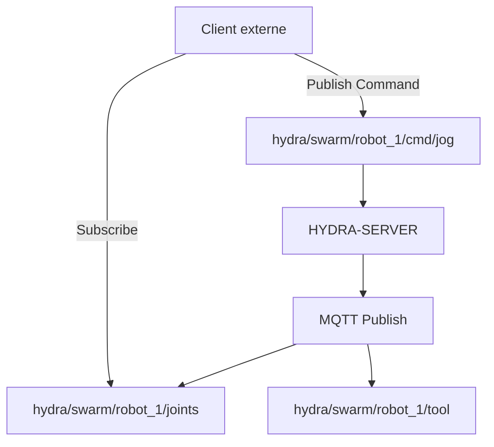

<!-- =============================================================================
HYDRA-UMC-MQTT-BROKER - MQTT broker for telemetry and integrations
Copyright (C) JuanenRac (Electro Hobby 3D) <electrohobby3d@gmail.com>
GPL-3.0-or-later - see LICENSE
============================================================================= -->

<p align="center">
  
</p>

# 📡 HYDRA-UMC-MQTT-BROKER

<p align="center"><a href="README.md">🇺🇸 English</a> | <a href="README_spa.md">🇪🇸 Español</a> | 🇫🇷 <b>Français</b> | <a href="README_ita.md">🇮🇹 Italiano</a> | <a href="README_deu.md">🇩🇪 Deutsch</a> | <a href="README_zho.md">🇨🇳 简体中文</a> | <a href="README_jpn.md">🇯🇵 日本語</a> | <a href="README_por.md">🇵🇹 Português</a></p>

### 🚀 Pont de télémétrie léger pour l'IoT et les intégrations externes

<p align="center">
  
  
  
  
  
  
</p>

---

**Vérification d'honnêteté - ce qui fonctionne réellement aujourd'hui :** le transport du broker (`src/server.ts`), l'ACL de topics (`src/acl.ts`), et l'authentification CONNECT (`src/auth.ts`) sont réels et testés (159 tests passants dans 12 fichiers ), et `tsc --noEmit` est propre. Ce ne sont pas des tests unitaires isolés contre des internes simulés - `tests/server.test.ts` connecte une vraie bibliothèque cliente `mqtt` via un vrai socket TCP à un vrai broker Aedes en cours d'exécution, et c'est ainsi qu'un vrai bug a été trouvé (l'étape `broker.listen()` d'Aedes 1.x omise, faisant silencieusement pendre chaque CONNECT). Le listener MQTT-sur-WebSocket et la limite de taille de payload fonctionnent de la même façon : réels, optionnels, et testés contre le broker. Ce qui n'est réellement pas construit : la découverte mDNS/Home Assistant n'est que planifiée - `server.ts` est un simple listener TCP sans aucun service de découverte - et la forme de topic `hydra/swarm/...` du diagramme ci-dessous est la forme future prévue une fois que le propre état de HYDRA-UMC-SERVER sera relié à MQTT, ce qui n'est pas encore arrivé ; seuls les topics `hydra/bridges/<name>/...` des 5 ponts de machines externes sont réels et câblés aujourd'hui. Voir `CHANGELOG.md` pour ce qui a été livré exactement jusqu'à présent.

---

> **État de la sûreté et de la cybersécurité :** cet écosystème n'est pas un système de sécurité certifié. Il n'existe pas encore de chaîne d'E-STOP matérielle, ni de limites ou de verrouillages imposés par le firmware, ni de commande de mouvement vérifiée ; les images de firmware sont contrôlées par CRC-32 et une signature Ed25519, et une compilation de version refuse les clés de développement publiées (les têtes d'outil et les cartes d'extension derrière le relais utilisent encore les chargeurs d'URTC, qui prennent un HMAC-SHA256 à clé partagée au lieu d'une signature) ; TLS et TLS mutuel sont optionnels et désactivés par défaut ; aucune carte propre n'a encore été assemblée ni testée. Lisez la [base de sécurité](https://github.com/JuanenRac/HYDRA-UMC-DOCS/blob/main/docs/SECURITY_BASELINE.md) et le [modèle de menaces](https://github.com/JuanenRac/HYDRA-UMC-DOCS/blob/main/docs/THREAT_MODEL.md) avant de vous fier à une affirmation d'ici pour la sécurité d'une personne.

---

## 📋 En un coup d'œil

| | |
|---|---|
| Version | `0.1.7` |
| Maturité | Fonctionnel |
| Tests | 159 (`npm test`) |
| Technologie | Node.js / TypeScript / Aedes MQTT broker (MQTT 3.1.1) / MQTT over WebSockets (ws) / TLS and mutual TLS (optional) |
| Cible | Le Raspberry Pi CM5 d'une cellule HYDRA-UMC |
| Sur matériel réel | Pas encore : aucune exécution sur du matériel réel n'est consignée pour cette version |

**Aller à :** [Présentation](#-présentation) · [Architecture](#-architecture) · [Démarrage rapide](#-démarrage-rapide) · [Tests](#-tests) · [Structure du dépôt](#-structure-du-dépôt) · [Projets liés](#-projets-liés)

## 🚦 État du projet

Chaque ligne est une partie de ce dépôt et le feu dit où elle en est aujourd'hui. Elle est écrite d'après ce que le dépôt peut montrer (tests, compilations, exécutions), pas d'après ce qui est prévu.

🟢 Fait et vérifié · 🟡 Fonctionne, avec des limites connues · 🟠 À moitié fait ou pas encore vérifié · 🔴 Pas fait ou ne fonctionne pas

| Domaine | État | Ce que cela veut dire ici |
|---|---|---|
| Logiciel | 🟡 | Fonctionne pour son usage principal ; la vérification d'honnêteté ci-dessus liste ce qui manque encore |
| Tests | 🟢 | 159 tests automatiques, exécutés à chaque modification |
| Matériel réel | 🔴 | Pas encore : aucune exécution sur du matériel réel n'est consignée pour cette version |
| Documentation | 🟢 | README en huit langues, vérifié par rapport au manifeste à chaque modification |

## 🎯 Présentation

**HYDRA-UMC-MQTT-BROKER** fournit une interface de messagerie asynchrone et légère pour l'écosystème HYDRA-UMC. Il permet aux appareils IoT externes, aux tableaux de bord et aux systèmes domotiques (comme Home Assistant) de s'abonner à la télémétrie des robots et de publier des commandes.

Il implémente la norme MQTT 3.1.1 (via Aedes, vérifié en conditions réelles - voir Architecture ci-dessous), offrant une distribution de données haute efficacité avec un surdébit minimal, ce qui le rend idéal pour les applications mobiles ou la surveillance à distance à faible bande passante.

### Caractéristiques principales :
* 🔌 **Ponts de Machines Externes :** `HYDRA-UMC-BRIDGE-CNC`/`-LASER`/`-OPENPNP`/`-PRINTER3D`/`-ROS2` atteignent chacun ce broker via leurs propres topics `hydra/bridges/<name>/...` - voir `docs/BRIDGE_TOPICS.md`. *(implémenté)*
* 📡 **Télémétrie Pub/Sub :** Distribution en moins d'une milliseconde des angles d'articulation, des états des outils et de la santé du système. *(prévu - l'état des robots ne passe pas encore par le broker ; aujourd'hui seuls les topics `hydra/bridges/<name>/...` des passerelles machine y circulent)*
* 🛠️ **Prise en charge de la découverte :** mDNS et auto-découverte Home Assistant pour une configuration facile. *(prévu - pas encore implémenté ; `src/server.ts` est aujourd'hui un simple écouteur TCP, sans aucun service de découverte)*
* 🔐 **Sécurité des sujets (Topics) :** ACL réelle et vérifiable par préfixe d'ID client pour la lecture et l'écriture de sujets robotiques spécifiques - un SUBSCRIBE avec caractère générique ne peut jamais accorder un accès plus large que sa règle. *(implémenté)*
* 🪪 **Authentification client :** L'authentification MQTT réelle et facultative par nom d'utilisateur/mot de passe au CONNECT (`MQTT_AUTH_JSON`) donne à l'ACL une identité de session vérifiée - le propre `clientIdPrefix` requis de chaque identifiant est également imposé, de sorte qu'un identifiant valide mais moins privilégié ne peut pas simplement choisir un ID client différent et plus privilégié pour hériter de ses permissions ACL. *(implémentée ; à associer à l'ACL)*
* 📏 **Limite de taille de payload :** Une limite réelle et optionnelle sur la taille du payload PUBLISH, configurable via `MAX_PAYLOAD_BYTES`. *(implémenté)*
* ⚡ **Prise en charge des Websockets :** MQTT-over-WebSockets pour les clients basés sur un navigateur - le même broker, un second écouteur réel et optionnel aux côtés du TCP brut existant (option `wsPort` / variable d'environnement `MQTT_WS_PORT`, port par défaut 8083). *(implémenté)*
* ⏳ **Expiration des messages retenus :** Un vrai TTL optionnel pour les messages retenus (option `retainedTtlMs` / variable d'environnement `MQTT_RETAINED_TTL_MS`) - un état retenu plus vieux que la limite est activement effacé au lieu d'être livré indéfiniment à chaque futur abonné. *(implémenté)*
* 🛡️ **Politique de production :** Un démarrage en production (`NODE_ENV=production`, que le Dockerfile définit) refuse de fonctionner sans `MQTT_AUTH_JSON` et `MQTT_ACL_JSON`, avec des mots de passe de moins de 16 caractères ou d'exemple, et sans une règle d'ACL couvrant le préfixe de chaque identifiant ; `MQTT_ALLOW_ANONYMOUS=1` dit volontairement qu'il s'agit d'un broker de laboratoire ouvert. L'ACL est évaluée selon l'identité prouvée par l'identifiant (son propre `clientIdPrefix`), et non selon le client ID choisi par le client ; les messages retenus expirent après 24 heures sauf si `MQTT_RETAINED_TTL_MS` dit autre chose ; `MQTT_BIND_HOST` / `MQTT_METRICS_HOST` choisissent l'interface sur laquelle écoutent les listeners. *(implémenté)*
* 🔐 **TLS hors loopback :** un démarrage en production refuse de s'exécuter quand l'écouteur MQTT en clair est ouvert au-delà de cette machine (le défaut est toutes les interfaces) et que TLS n'est pas configuré ; lier à `127.0.0.1` avec `MQTT_BIND_HOST`, configurer TLS ou accepter volontairement un réseau de confiance avec `MQTT_ALLOW_PLAINTEXT=1`. Chaque démarrage avertit d'un écouteur en clair hors loopback. *(implémenté)*
* 🔒 **TLS :** MQTT sur TLS réel et optionnel (`MQTT_TLS_CERT` / `MQTT_TLS_KEY`, port 8883, plus WebSocket sécurisé avec `MQTT_WSS_PORT`) et TLS mutuel optionnel (`MQTT_TLS_CA` avec `MQTT_TLS_REQUIRE_CLIENT_CERT=1`). *(implémenté)*
* 🧰 **Mots de passe hachés, identité par certificat et limites pour clients lents (tout est optionnel) :** un mot de passe de `MQTT_AUTH_JSON` peut être stocké sous la forme `scrypt$...` (à écrire avec `npm run hash-password` ; les mots de passe en clair continuent de fonctionner et le hachage est calculé hors de la boucle d'événements) ; `MQTT_TLS_CERT_IDENTITY=1` (avec TLS mutuel) identifie un client par le CN de son certificat vérifié, qui doit préfixer son ID client, et applique l'ACL de ce nom sans mot de passe ; `MQTT_CONNECT_TIMEOUT_MS`, `MQTT_KEEPALIVE_LIMIT_SECONDS` et `MQTT_QUEUE_LIMIT` bornent la durée et la gourmandise d'une connexion avant sa fermeture. Tout est désactivé par défaut. *(implémenté)*
* 📊 **Métriques Prometheus :** Écouteur réel et optionnel `GET /metrics` (option `metricsPort` / variable `MQTT_METRICS_PORT`, port par défaut 9883) indiquant les clients connectés, les messages reçus, les refus d'ACL et les octets entrants/sortants. *(implémenté)*

## 🧩 Rôle dans HYDRA-UMC

**HYDRA-UMC-MQTT-BROKER** est le centre de messages de l'écosystème : un broker MQTT 3.1.1 (Aedes) avec authentification facultative par client et ACL de topics, entre tableaux de bord, domotique, ponts machines (`HYDRA-UMC-BRIDGE-*`) et `HYDRA-UMC-SERVER`. Il route les messages ; la décision de sécurité reste au destinataire.

## 🏛️ Architecture

<p align="center">
  
</p>

<details>
<summary>Version texte du diagramme (Mermaid)</summary>



</details>

### STRUCTURE DES SUJETS MQTT

**Note d'honnêteté :** la forme de topic `hydra/swarm/...` ci-dessus
illustre la forme *visée* une fois que l'état propre de
HYDRA-UMC-SERVER sera relié à MQTT - ce câblage n'est pas encore fait
(le propre commentaire d'en-tête de `src/server.ts` : "lands once that
wiring is defined"), donc rien ne publie sur `hydra/swarm/...`
aujourd'hui. Les topics réels et câblés aujourd'hui sont l'espace de
noms `hydra/bridges/<name>/...` des 5 ponts machine externes (voir
`docs/BRIDGE_TOPICS.md`) et la propre forme de topics VDA 5050 de
HYDRA-UMC-BRIDGE-AMR.

### ARCHITECTURE & DÉCISIONS DE CONCEPTION

* **Pourquoi c'est un frère, pas un sous-module, de HYDRA-UMC-GATEWAY-INDUSTRIAL.** Chaque adaptateur de protocole est un processus déployable/redémarrable séparément - un problème de broker ne fait jamais tomber les adaptateurs OPC-UA ou MTConnect qui tournent à côté.
* **Pourquoi un vrai broker MQTT, pas juste un client publiant vers un broker externe.** Posséder le broker signifie que le propre flux d'événements de cette cellule (changements d'état robot, alarmes) est disponible pour tout abonné MQTT du réseau d'usine sans dépendre de l'accessibilité d'un broker externe géré séparément.
* **Pourquoi `src/server.ts` est délibérément mince.** Aedes fait le vrai travail du protocole MQTT (framing de CONNECT/PUBLISH/SUBSCRIBE, QoS, messages retenus et de testament) ; ce fichier n'est que le transport TCP simple dont Aedes a besoin, le listener optionnel MQTT-sur-WebSocket, le câblage de l'ACL/auth/limite de payload, et la journalisation au niveau du processus. `buildBroker()` est exporté pour que les tests démarrent un vrai broker sur un port éphémère et y connectent de vrais clients MQTT.
* **Comment cela s'intègre dans le reste de l'écosystème.** Un service frère sous HYDRA-UMC-GATEWAY-INDUSTRIAL - relie le propre flux d'événements de HYDRA-UMC-SERVER à de vrais sujets MQTT.
* **Un vrai bug a été trouvé et corrigé ici : le broker n'acceptait en réalité jamais aucun client.** Aedes 1.x a déplacé la configuration de la persistance/mqemitter dans une étape asynchrone explicite `broker.listen()` (un vrai changement d'API par rapport à la forme factory de la 0.x) ; sans cela, un vrai `CONNECT` atteignait le broker via un vrai socket TCP mais restait bloqué silencieusement jusqu'à ce que le propre délai de connack du client expire - le broker semblait "actif" (le port acceptait les connexions) mais aucun client ne pouvait jamais terminer une session. Découvert via un vrai client `mqtt` expirant dans les propres tests de ce projet, pas par inspection. `tests/server.test.ts` connecte désormais une vraie bibliothèque cliente MQTT à un vrai broker via un vrai socket - CONNECT, livraison de PUBLISH, isolation des sujets et messages retenus, tout est testé pour de vrai.
* **Pourquoi l'ACL de sujets vérifie la *portée* de l'abonnement, pas seulement le chevauchement du filtre.** La propre requête SUBSCRIBE d'un client est elle-même un filtre et peut porter des caractères génériques `+`/`#` - vérifier naïvement si « le filtre demandé chevauche celui autorisé » permettrait à un client de s'abonner avec un caractère générique plus large (p. ex. `hydra/robots/#`) que ce que sa règle accorde réellement (p. ex. `hydra/robots/+/status`) et de voir silencieusement des sujets pour lesquels il n'a jamais été autorisé. `src/acl.ts`, avec sa fonction `isSubscriptionWithinScope()`, effectue à la place une vérification réelle, segment par segment - prouvé par de vrais tests, y compris un cas où la propre tentative d'un robot d'étendre sa portée via un SUBSCRIBE avec caractère générique est refusée.
* **Pourquoi un PUBLISH refusé ferme toute la connexion, plutôt que de simplement faire un NACK sur un seul message.** C'est le comportement réel propre d'Aedes (vérifié en exécutant un vrai client contre lui, pas supposé d'après la documentation) - `authorizePublish` renvoyant une erreur détruit la connexion du client. La conception de l'ACL/limite de payload ici travaille avec ce comportement, pas contre lui : un client qui continue d'être déconnecté pour violation de son ACL est un signal clair et net pour corriger la configuration de cet appareil, pas un message silencieusement abandonné qu'il pourrait ne jamais remarquer.
* **Pourquoi la configuration de l'ACL/limite de payload réside dans des variables d'environnement (`MQTT_ACL_JSON`/`MAX_PAYLOAD_BYTES`), pas dans un fichier de configuration.** Cela correspond à la convention `PORT` déjà existante de ce projet (voir `.env.example`) et à la façon dont il est réellement déployé (environnement systemd/Docker, pas un fichier monté) - `parseAclConfig()` fait échouer le démarrage de manière bruyante en cas de JSON malformé plutôt que de s'exécuter silencieusement sans protection.
* **Pourquoi ce broker parle MQTT 3.1.1, pas MQTT v5.** `aedes@1.1.1` (la dépendance figée) n'implémente que MQTT 3.1/3.1.1 - vérifié en conditions réelles en connectant un vrai client `mqtt` avec `protocolVersion: 5`, que le broker refuse activement (`Connection refused: Unacceptable protocol version`), et confirmé par la propre documentation amont d'Aedes (le support MQTT 5.0 vit sur une branche séparée, non publiée). Chaque client de cet écosystème (les bridges `mqtt_transport.py`, `Vda5050Publisher`, les propres tests de ce dépôt) ne négocie déjà que la version 3.1.1, donc ceci est une correction de documentation, pas un changement de comportement.

## 🚀 Démarrage rapide

Nécessite Node.js 20 ou plus récent avec npm.

```bash
npm install
npm test
npm run build
npm start
```

## 🧪 Tests

159 tests automatiques s'exécutent avec `npm test`. Ils n'ont besoin ni de matériel ni de rien en dehors de cette machine.

La CI exécute `HYDRA_UMC_CI=1 python tools/ci_validate.py`, qui vérifie le manifeste, les documents, les huit README et les images.

## 🏗️ Compilation et publication

### Prérequis
- [Node.js](https://nodejs.org/) (v18 ou supérieur recommandé)
- npm

### Installation
```bash
npm install
```

### Mode Développement
Exécute le broker directement avec `tsx` (sans bundler) :
- **Windows :** double-cliquer sur `dev.bat` ou exécuter `npm run dev`
- **Linux/Mac :** exécuter `./dev.sh` ou `npm run dev`

### Build de Production
Regroupe le broker en un seul fichier déployable avec esbuild :
- **Windows :** double-cliquer sur `build.bat` ou exécuter `npm run build`
- **Linux/Mac :** exécuter `./build.sh` ou `npm run build`

Puis démarrez-le avec :
```bash
npm start
```

Le broker écoute sur `0.0.0.0:1883` (MQTT/TCP en clair, le port par défaut
enregistré par l'IANA) - pointez n'importe quel client MQTT
(`mosquitto_sub`, Home Assistant, MQTT Explorer, ...) vers `<host>:1883`.

### Gestion des versions
`npm run build` ne fait que regrouper le serveur et ne change jamais la version ; `python tools/hydra_project_tool.py bump` la fait monter (via `bump_manifest_version.py`) - un « compteur kilométrique » en base 10 : patch +1 par bump,
avec report vers minor (et de minor vers major) au-delà de 9 plutôt que
d'atteindre un segment à deux chiffres (`0.0.9` -> `0.1.0`, pas `0.0.10`).

## 📂 Structure du dépôt

<p align="center">
  
</p>

<details>
<summary>Version texte de l'arborescence</summary>

```text
HYDRA-UMC-MQTT-BROKER/
├── src/                       Code source (Node/TypeScript - Broker, Pont, Sécurité)
├── tests/                     Suite Vitest - ACL, authentification et comportement broker/pont
├── docs/                      Documentation et catalogue de sujets
├── images/                    Médias et diagrammes
├── scripts/                   Scripts utilitaires (bump-version.mjs)
├── tools/                     ci_validate.py - validation manifest/CHANGELOG/docs utilisée par la CI
├── .github/                   workflow de CI et modèles de tickets
├── CHANGELOG.md               ce qui a changé à chaque version
├── Dockerfile                 image de conteneur
├── build-test.sh              vérification de build sans modification
├── build.sh                   construit et vérifie ; ne change jamais la version
├── bump_manifest_version.py   synchronise la version du manifeste
├── dev.sh                     mode développement
├── hydra-umc.project.json     manifeste : version, maturité, famille
├── package.json               métadonnées et scripts du paquet
└── test.sh                    lance les tests
```

</details>

## 🗺️ Feuille de route et limites connues

**Limites connues aujourd'hui**

* **Phase 1 :** Implémentation d'OPC-UA Pub/Sub pour l'échange de données à haute vitesse et le pontage des protocoles hérités.
* **Phase 2 :** Cluster de brokers MQTT pour la gestion massive des appareils IoT et une haute simultanéité.
* **Phase 3 :** Prise en charge de l'adaptateur MTConnect pour l'intégration de machines CNC et d'automates multi-fournisseurs.
* **Phase 4 :** Prise en charge de la spécification Sparkplug B pour l'alignement de l'IoT industriel et pont de télémétrie unifié.

## 🌍 Langues

Ce README et les documents du dépôt existent en huit langues : anglais, espagnol, allemand, français, italien, japonais, chinois et portugais (Portugal). Ils sont écrits ensemble et la CI vérifie que les huit fichiers ont les mêmes sections et les mêmes liens. Ce dépôt n'a ni écran ni catalogue de messages propre, il n'y a donc aucune chaîne d'interface à traduire.

## 🔗 Projets liés

Ce projet fait partie de l'écosystème robotique HYDRA-UMC du même auteur (JuanenRac / Electro Hobby 3D). Bon à savoir, car une demande pourrait en réalité concerner l'un de ceux-ci plutôt que ce dépôt.

**Projet Parent**
- **[HYDRA-UMC-GATEWAY-INDUSTRIAL](https://github.com/JuanenRac/HYDRA-UMC-GATEWAY-INDUSTRIAL)** — hub d'intégration relayant vers les protocoles industriels, avec une vraie couche de liste blanche de commandes/contre-pression ; le parent dont ce dépôt est un adaptateur de protocole spécifique, au sein de sa propre passerelle industrielle.

**Projets Frères** — les autres adaptateurs de protocole de la propre passerelle industrielle de HYDRA-UMC-GATEWAY-INDUSTRIAL
- **[HYDRA-UMC-OPCUA-SERVER](https://github.com/JuanenRac/HYDRA-UMC-OPCUA-SERVER)** — vrai espace d'adressage OPC-UA, vérifié avec une vraie session client du protocole binaire.
- **[HYDRA-UMC-MTCONNECT-ADAPTER](https://github.com/JuanenRac/HYDRA-UMC-MTCONNECT-ADAPTER)** — vrais points de terminaison XML MTConnect `/probe` et `/current`, avec sortie en mode dégradé.

**Directement Liés**
- **[HYDRA-UMC-SERVER](https://github.com/JuanenRac/HYDRA-UMC-SERVER)** — le vrai backend headless (REST/WebSocket) auquel parle réellement chaque client de contrôle — la source de l'état que cet adaptateur expose.
- **[HYDRA-UMC-BRIDGE-CNC](https://github.com/JuanenRac/HYDRA-UMC-BRIDGE-CNC)** — coordinateur haut niveau pour cellules CNC avec accès au statut/octets de contrôle GRBL (testé uniquement contre un émulateur) — embarque son propre `mqtt_transport.py` atteignant ce broker via ses propres topics `hydra/bridges/<nom>/...` ; voir le propre `docs/BRIDGE_TOPICS.md` de ce dépôt pour le catalogue de topics réel et partagé.
- **[HYDRA-UMC-BRIDGE-LASER](https://github.com/JuanenRac/HYDRA-UMC-BRIDGE-LASER)** — coordinateur de cellules laser lisant 3 signaux GPIO de clé/enceinte/verrouillage (testé uniquement contre une puce simulée ; il ne peut ni armer ni tirer un laser) — embarque son propre `mqtt_transport.py` atteignant ce broker via ses propres topics `hydra/bridges/<nom>/...` ; voir le propre `docs/BRIDGE_TOPICS.md` de ce dépôt pour le catalogue de topics réel et partagé.
- **[HYDRA-UMC-BRIDGE-OPENPNP](https://github.com/JuanenRac/HYDRA-UMC-BRIDGE-OPENPNP)** — coordinateur haut niveau sûr pour le flux de cartes du pick-and-place OpenPnP — embarque son propre `mqtt_transport.py` atteignant ce broker via ses propres topics `hydra/bridges/<nom>/...` ; voir le propre `docs/BRIDGE_TOPICS.md` de ce dépôt pour le catalogue de topics réel et partagé.
- **[HYDRA-UMC-BRIDGE-PRINTER3D](https://github.com/JuanenRac/HYDRA-UMC-BRIDGE-PRINTER3D)** — frontière de coordination sûre pour imprimantes 3D Moonraker/Klipper, avec de vraies commandes de tâche contrôlées — embarque son propre `mqtt_transport.py` atteignant ce broker via ses propres topics `hydra/bridges/<nom>/...` ; voir le propre `docs/BRIDGE_TOPICS.md` de ce dépôt pour le catalogue de topics réel et partagé.
- **[HYDRA-UMC-BRIDGE-ROS2](https://github.com/JuanenRac/HYDRA-UMC-BRIDGE-ROS2)** — coordinateur avec un transport ROS 2 rclpy à importation paresseuse (pas encore exécuté contre une installation ROS 2) — embarque son propre `mqtt_transport.py` atteignant ce broker via ses propres topics `hydra/bridges/<nom>/...` ; voir le propre `docs/BRIDGE_TOPICS.md` de ce dépôt pour le catalogue de topics réel et partagé.
- **[HYDRA-UMC-BRIDGE-AMR](https://github.com/JuanenRac/HYDRA-UMC-BRIDGE-AMR)** — frontière de coordination pour les flottes AGV/AMR via un éditeur MQTT VDA 5050 (testé uniquement contre une flotte émulée) — un autre vrai client de ce même broker : `Vda5050Publisher` envoie des dispatches validés comme de vrais messages VDA 5050 `order`/`instantActions`, selon la propre forme de topic de VDA 5050 plutôt que le schéma `hydra/bridges/...` utilisé par les autres bridges.

**Fait Également Partie de l'Écosystème**

*Matériel & Plateforme de Base*
- **[HYDRA-UMC](https://github.com/JuanenRac/HYDRA-UMC)** — la conception de la carte mère du bras robotique : hôte CM5 + coprocesseur STM32H745 double cœur, destinée à coordonner jusqu'à 8 bras-outils via CAN-OTA/SPI-OTA (firmware à un stade précoce ; aucune carte assemblée pour l'instant).
- **[HYDRA-UMC-OS](https://github.com/JuanenRac/HYDRA-UMC-OS)** — couche produit reproductible sur Raspberry Pi OS pour le CM5 : agent en lecture seule, config/profils validés, provisionnement WiFi de premier contact.
- **[HYDRA-UMC-SDK](https://github.com/JuanenRac/HYDRA-UMC-SDK)** — le contrat JSON-Schema partagé et la barrière logicielle de contrôle des jobs contre laquelle chaque bridge valide ses commandes (pas une fonction de sécurité certifiée).
- **[HYDRA-UMC-CONNECTOR-HUB](https://github.com/JuanenRac/HYDRA-UMC-CONNECTOR-HUB)** — registre déclaratif et validateur de manifestes d'adaptateur pour les connecteurs de machines externes ; étend la propre idée de contrat du SDK aux machines externes sans remplacer les projets de passerelle industrielle.

*Backend Central & Clients*
- **[HYDRA-UMC-STUDIO](https://github.com/JuanenRac/HYDRA-UMC-STUDIO)** — tableau de bord de contrôle web avec visualisation 3D multi-robot en temps réel.
- **[HYDRA-UMC-SUITE](https://github.com/JuanenRac/HYDRA-UMC-SUITE)** — centre de commande d'essaim de bureau (PySide6) pour plusieurs serveurs à la fois, empaqueté en exécutable autonome.
- **[HYDRA-UMC-ANDROID-CONTROL](https://github.com/JuanenRac/HYDRA-UMC-ANDROID-CONTROL)** — application de contrôle Android native avec connexion biométrique et un compagnon Wear OS jumelé.
- **[HYDRA-UMC-IOS-CONTROL](https://github.com/JuanenRac/HYDRA-UMC-IOS-CONTROL)** — application de contrôle iOS/iPadOS (Flutter) avec synchronisation WebSocket en temps réel.
- **[HYDRA-UMC-DSI](https://github.com/JuanenRac/HYDRA-UMC-DSI)** — interface tactile native pour l'écran tactile DSI 7" embarqué, intégrée directement sur le CM5.
- **[HYDRA-UMC-EDITOR-URDF](https://github.com/JuanenRac/HYDRA-UMC-EDITOR-URDF)** — créateur/éditeur graphique de bureau pour URDF qui envoie les modèles terminés vers le propre catalogue de STUDIO.
- **[HYDRA-UMC-EDITOR-STL](https://github.com/JuanenRac/HYDRA-UMC-EDITOR-STL)** — éditeur de bureau de modèles STL, transformant/remplaçant/retirant/ajoutant de vraies pièces dans le même catalogue de modèles qu'édite aussi HYDRA-UMC-EDITOR-URDF.
- **[HYDRA-UMC-BRIDGE-DROIDS](https://github.com/JuanenRac/HYDRA-UMC-BRIDGE-DROIDS)** — frontière de coordination pour droïdes à pattes/humanoïdes, avec un émetteur de commandes Boston Dynamics Spot (testé uniquement contre un émulateur).
- **[HYDRA-UMC-BRIDGE-UAV](https://github.com/JuanenRac/HYDRA-UMC-BRIDGE-UAV)** — frontière de coordination pour UAV équipés de caméra, avec un émetteur de commandes MAVLink (testé uniquement contre un émulateur).

*Plateforme d'Outils URTC*
- **[URTC](https://github.com/JuanenRac/URTC)** — firmware pour la carte physique Universal Robot Tool Controller, plus de 25 profils d'outil sur bus CAN.
- **[URTC-FLASHER](https://github.com/JuanenRac/URTC-FLASHER)** — outil de bureau à interface graphique pour flasher les cartes URTC, CAN-OTA plus SWD/JTAG puce complète.
- **[URTC-TESTER](https://github.com/JuanenRac/URTC-TESTER)** — outil de bureau de diagnostic CAN-bus en direct pour cartes URTC, un panneau par profil d'outil.
- **[URTC-WEB-STUDIO](https://github.com/JuanenRac/URTC-WEB-STUDIO)** — alternative basée navigateur à URTC-TESTER via la Web Serial API, sans installation locale.
- **[URTC-GATEWAY](https://github.com/JuanenRac/URTC-GATEWAY)** — passerelle devant le bus CAN d'URTC : liste d'identifiants autorisés, limite de débit et clé de session ; logiciel testé sur ordinateur, pas encore sur un bus réel.

*Nœud IA de Vision (Hailo-8)*
- **[HYDRA-UMC-VISION-NODE](https://github.com/JuanenRac/HYDRA-UMC-VISION-NODE)** — hub d'intégration pour le pipeline de vision Hailo-8, avec une vraie vérification de disponibilité matérielle par étape.
- **[HYDRA-UMC-DETECTION-HEF](https://github.com/JuanenRac/HYDRA-UMC-DETECTION-HEF)** — registre réel de modèles compilés avec vérification de chargement sécurisé par architecture Hailo/checksum.
- **[HYDRA-UMC-VISION-STREAMER](https://github.com/JuanenRac/HYDRA-UMC-VISION-STREAMER)** — générateur réel de pipeline GStreamer + config MediaMTX, avec une vraie frontière d'intégration HailoRT.
- **[HYDRA-UMC-VISUAL-SERVOING-API](https://github.com/JuanenRac/HYDRA-UMC-VISUAL-SERVOING-API)** — loi de correction Position-Based Visual Servoing avec autorisation conditionnée à l'état de zone ; pas encore d'estimation de pose par caméra.
- **[HYDRA-UMC-SAFETY-ZONES](https://github.com/JuanenRac/HYDRA-UMC-SAFETY-ZONES)** — logique v0 de violation de zone, de fraîcheur de calibration et de demande d'E-STOP qui lit les positions d'objets dans un fichier ; aucun détecteur ne l'alimente et aucun E-STOP physique n'y est encore relié.

*Nœud IA Cognitif (Hailo-10)*
- **[HYDRA-UMC-COGNITIVE-NODE](https://github.com/JuanenRac/HYDRA-UMC-COGNITIVE-NODE)** — hub d'intégration pour le pipeline cognitif Hailo-10 (orchestration LLM/VLA/voix).
- **[HYDRA-UMC-VLA-ENGINE](https://github.com/JuanenRac/HYDRA-UMC-VLA-ENGINE)** — vrai encodage/décodage de jetons d'action et génération de trajectoire pour un modèle Vision-Language-Action.
- **[HYDRA-UMC-VOICE-UI](https://github.com/JuanenRac/HYDRA-UMC-VOICE-UI)** — vrai front-end vocal (VAD + analyseur d'intention) avec un relais Watch borné et soumis à confirmation.
- **[HYDRA-UMC-SEMANTIC-PLANNER](https://github.com/JuanenRac/HYDRA-UMC-SEMANTIC-PLANNER)** — vraie décomposition de tâches basée sur des règles et récupération sémantique d'erreurs sur les codes d'erreur MCU.
- **[HYDRA-UMC-DOCS-QA](https://github.com/JuanenRac/HYDRA-UMC-DOCS-QA)** — vraie recherche documentaire TF-IDF (bibliothèque standard uniquement) sur les propres documents Markdown de cet écosystème.
- **[HYDRA-UMC-LOCAL-TECHNICIAN](https://github.com/JuanenRac/HYDRA-UMC-LOCAL-TECHNICIAN)** — technicien de maintenance IA local et à portes de politique pour l'écosystème lui-même - observe, diagnostique et propose des corrections ; les deux niveaux de risque les plus élevés ne sont délibérément pas encore implémentés.

*Orchestration & Essaim*
- **[HYDRA-UMC-ORCHESTRATOR](https://github.com/JuanenRac/HYDRA-UMC-ORCHESTRATOR)** — hub d'intégration avec un vrai contrat de rapport de santé gRPC/Protobuf et une machine à états de mission.
- **[HYDRA-UMC-JOB-DISPATCHER](https://github.com/JuanenRac/HYDRA-UMC-JOB-DISPATCHER)** — vraie file de tâches basée sur la priorité avec déduplication, via une vraie API HTTP.
- **[HYDRA-UMC-NODE-HEALING](https://github.com/JuanenRac/HYDRA-UMC-NODE-HEALING)** — vrai chien de garde de santé de flotte basé sur gRPC, avec retry/backoff et détection d'incohérence d'identité.
- **[HYDRA-UMC-PATH-PLANNER-3D](https://github.com/JuanenRac/HYDRA-UMC-PATH-PLANNER-3D)** — vrai planificateur de trajectoire 3D basé sur RRT, avec vraie validation des collisions obstacle/espace de travail.
- **[HYDRA-UMC-SWARM-SYNC](https://github.com/JuanenRac/HYDRA-UMC-SWARM-SYNC)** — vraie synchronisation d'état CRDT LWW-Element-Map, testée par propriétés pour la convergence multi-cellule.

*Jumeau Numérique & Simulation*
- **[HYDRA-UMC-TWIN](https://github.com/JuanenRac/HYDRA-UMC-TWIN)** — hub d'intégration pour le moteur de jumeau numérique, avec un vrai contrat de synchronisation par compatibilité de version.
- **[HYDRA-UMC-HIL-BRIDGE](https://github.com/JuanenRac/HYDRA-UMC-HIL-BRIDGE)** — routeur hardware-in-the-loop avec un verrouillage logiciel de collision entre simulation et matériel réel (testé sans matériel réel).
- **[HYDRA-UMC-PHYSICS-REPLICA](https://github.com/JuanenRac/HYDRA-UMC-PHYSICS-REPLICA)** — vraie cinématique directe et validation des limites articulaires sur un vrai sous-ensemble URDF.
- **[HYDRA-UMC-SYNTHETIC-DATA-GEN](https://github.com/JuanenRac/HYDRA-UMC-SYNTHETIC-DATA-GEN)** — vrai générateur procédural de scènes 2D avec export d'annotations YOLO/COCO.

*Données & Analytique*
- **[HYDRA-UMC-DATALAKE](https://github.com/JuanenRac/HYDRA-UMC-DATALAKE)** — vrai magasin de séries temporelles basé sur sqlite3, avec une vraie API HTTP d'ingestion/requête.
- **[HYDRA-UMC-ANOMALY-DETECTOR](https://github.com/JuanenRac/HYDRA-UMC-ANOMALY-DETECTOR)** — vrai détecteur d'anomalies FFT + ligne de base statistique, avec surveillance de dérive.
- **[HYDRA-UMC-PRODUCTION-REPORTS](https://github.com/JuanenRac/HYDRA-UMC-PRODUCTION-REPORTS)** — vrai calcul OEE/disponibilité sur l'historique de DATALAKE, avec export CSV reproductible.
- **[HYDRA-UMC-TELEMETRY-COLLECTOR](https://github.com/JuanenRac/HYDRA-UMC-TELEMETRY-COLLECTOR)** — vrai pipeline d'ingestion CAN/WebSocket vers DATALAKE, avec déduplication par séquence.

*Outils Complémentaires & Opérations de l'Écosystème*
- **[HYDRA-UMC-DASHBOARD-AI](https://github.com/JuanenRac/HYDRA-UMC-DASHBOARD-AI)** — panneaux Smart Summaries et Anomaly Highlighting sur DATALAKE/ANOMALY-DETECTOR, avec un repli statistique honnête.
- **[HYDRA-UMC-TOOL-CLI](https://github.com/JuanenRac/HYDRA-UMC-TOOL-CLI)** — CLI de flotte avec un vrai contrat de codes de sortie stable, un vrai client en direct de la propre API de HYDRA-UMC-SERVER.
- **[HYDRA-UMC-WATCH](https://github.com/JuanenRac/HYDRA-UMC-WATCH)** — application compagnon WearOS avec des motifs d'alerte haptique et un relais vocal vers le téléphone jumelé (pas encore exécutée sur une montre physique).
- **[URTC-SMART-RACK](https://github.com/JuanenRac/URTC-SMART-RACK)** — firmware pour un rack de montage de cartes avec décodage réel d'ID d'outil et logique de préchauffage Smart Idle.
- **[URTC-VISION-TOOL](https://github.com/JuanenRac/URTC-VISION-TOOL)** — firmware plus un vrai compagnon de vision Python pour une tête d'outil d'inspection thermique/RGB.
- **[HYDRA-UMC-UPDATER](https://github.com/JuanenRac/HYDRA-UMC-UPDATER)** — outil administratif de bureau qui découvre, clone et met à jour chaque dépôt de cet écosystème.
- **[HYDRA-UMC-OS-REBUILDER](https://github.com/JuanenRac/HYDRA-UMC-OS-REBUILDER)** — outil de bureau Windows/Linux qui construit une image de la CM5 prête à graver, préchargée avec les versions les plus actuelles de l'écosystème, avec une configuration de premier démarrage Wi-Fi/utilisateur/SSH façon Raspberry Pi Imager.
- **[HYDRA-UMC-OPS-AGENT](https://github.com/JuanenRac/HYDRA-UMC-OPS-AGENT)** — coordinateur d'incidents de maintenance : un rôle edge à faible privilège collecte un instantané d'inventaire/santé assaini, un rôle control-plane le rend en lecture seule et demande à un fournisseur d'IA de suggérer un diagnostic - n'applique jamais de correctif ni ne déploie rien.
- **[HYDRA-UMC-DEV-SERVER](https://github.com/JuanenRac/HYDRA-UMC-DEV-SERVER)** — hôte de développement reproductible (Raspberry Pi 5 / CM5) qui héberge le code source de l'écosystème et exécute des tâches de compilation/test délimitées via une file d'attente durable ; un rôle de développement dédié, explicitement distinct d'un CM5 opérationnel.

## 📚 Documentation

Où lire la suite :

* **[docs/BRIDGE_TOPICS.md](docs/BRIDGE_TOPICS.md)** — le catalogue réel et partagé des topics `hydra/bridges/<name>/...` que chaque pont machine externe (CNC/Laser/OpenPnP/Printer3D/ROS2) utilise réellement contre ce broker.
* [Base de sécurité de l'écosystème](https://github.com/JuanenRac/HYDRA-UMC-DOCS/blob/main/docs/SECURITY_BASELINE.md)
* [Modèle de menaces de l'écosystème](https://github.com/JuanenRac/HYDRA-UMC-DOCS/blob/main/docs/THREAT_MODEL.md)
* [Journal des modifications de ce dépôt](CHANGELOG.md)
* [Licence de ce dépôt](LICENSE.md)

## 🤝 Contribuer et communauté

* Avant une pull request, exécutez `HYDRA_UMC_CI=1 py -3 tools/ci_validate.py` (ou `HYDRA_UMC_CI=1 python3 tools/ci_validate.py`) : il doit afficher `CI_VALIDATION=PASS`. N'exécutez pas `build.sh` ni `build.bat` pour cette vérification ; compiler n'est pas vérifier.
* Les huit README sont écrits à partir d'une source unique dans HYDRA-UMC-DOCS ; ne les modifiez pas à la main. Changez la source et réécrivez-les avec `tools/make_readmes.py`.
* N'affirmez pas dans un README ce qui n'a pas tourné : écrivez « simulé » ou « non essayé sur matériel » quand c'est la vérité.
* Voir [CONTRIBUTING.md](CONTRIBUTING.md), le [code de conduite](CODE_OF_CONDUCT.md), [SECURITY.md](SECURITY.md) et [SUPPORT.md](SUPPORT.md).

## 👤 AUTEUR

**JuanenRac (Electro Hobby 3D)** · electrohobby3d@gmail.com

## 📜 LICENCE

GPL-3.0-or-later - [LICENSE](LICENSE).
