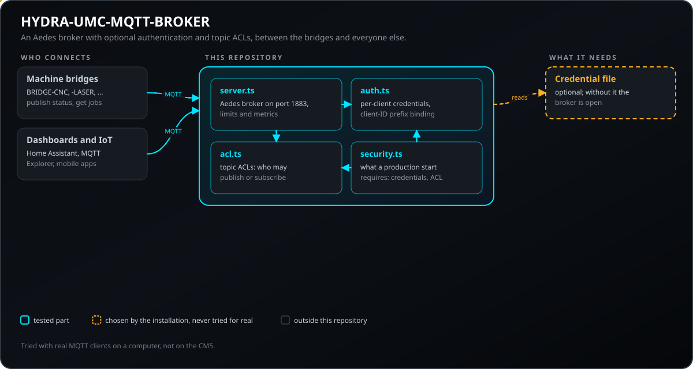
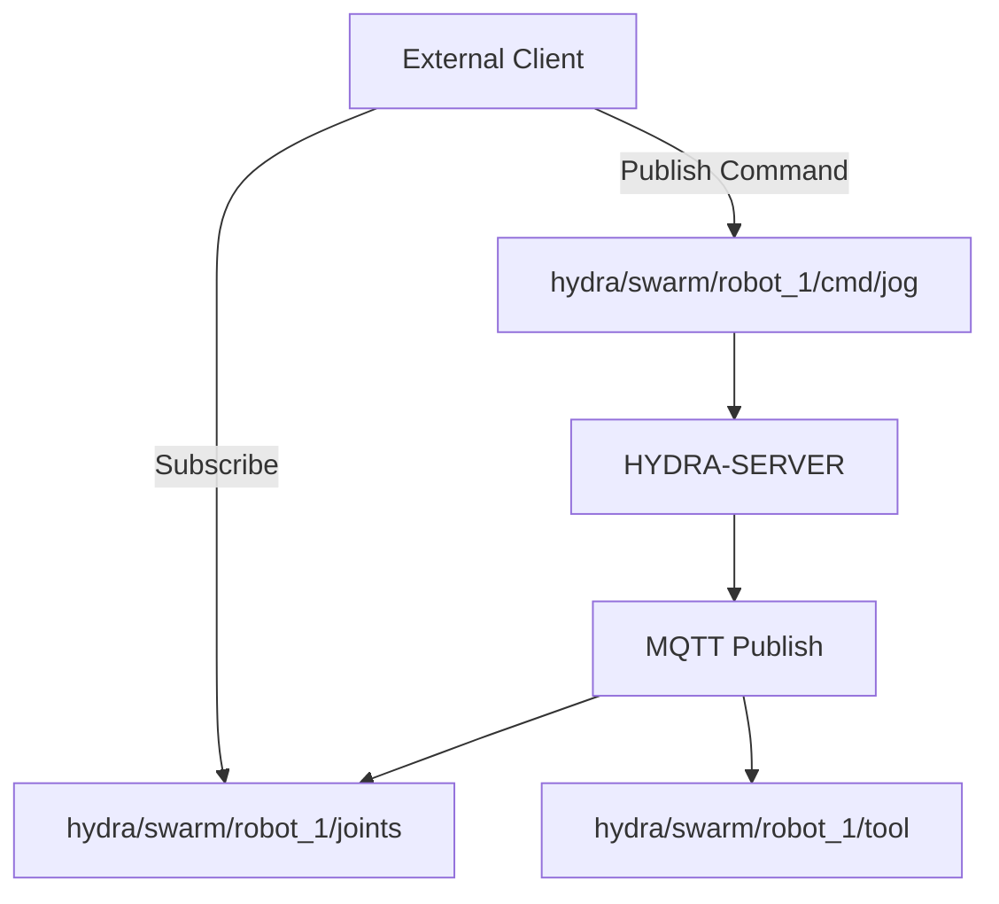
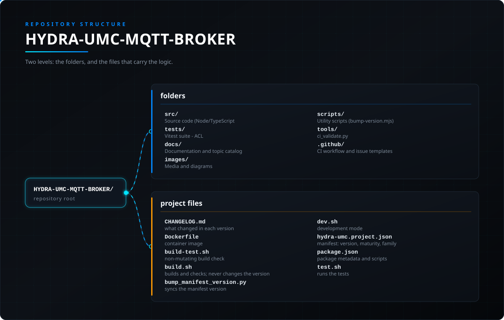

<!-- =============================================================================
HYDRA-UMC-MQTT-BROKER - MQTT broker for telemetry and integrations
Copyright (C) JuanenRac (Electro Hobby 3D) <electrohobby3d@gmail.com>
GPL-3.0-or-later - see LICENSE
============================================================================= -->

<p align="center">
  
</p>

# 📡 HYDRA-UMC-MQTT-BROKER

<p align="center"><a href="README.md">🇺🇸 English</a> | <a href="README_spa.md">🇪🇸 Español</a> | <a href="README_fra.md">🇫🇷 Français</a> | <a href="README_ita.md">🇮🇹 Italiano</a> | <a href="README_deu.md">🇩🇪 Deutsch</a> | <a href="README_zho.md">🇨🇳 简体中文</a> | <a href="README_jpn.md">🇯🇵 日本語</a> | 🇵🇹 <b>Português</b></p>

### 🚀 Ponte de telemetria leve para IoT e integrações externas

<p align="center">
  
  
  
  
  
  
</p>

---

**Verificação de honestidade - o que realmente funciona hoje:** o transporte do broker (`src/server.ts`), a ACL de tópicos (`src/acl.ts`), a autenticação CONNECT (`src/auth.ts`) e a política de produção (`src/security.ts`) são reais e testados (163 testes a passar em 12 ficheiros, `tests/security.test.ts`, entre outros), e `tsc --noEmit` está limpo. Não são testes unitários isolados contra componentes internos simulados - o `tests/server.test.ts` liga um cliente `mqtt` real por um socket TCP real a um broker Aedes real em execução, e foi assim que se encontrou um erro real (o passo `broker.listen()` do Aedes 1.x ser ignorado, bloqueando em silêncio todos os CONNECT). O listener MQTT-sobre-WebSocket e o limite de tamanho de payload são iguais: reais, opcionais e testados com o broker. O que genuinamente não está feito: a descoberta mDNS/Home Assistant está apenas planeada - o `server.ts` é um listener TCP simples sem qualquer serviço de descoberta - e a forma de tópicos `hydra/swarm/...` do diagrama abaixo é a forma futura pretendida quando o estado do próprio HYDRA-UMC-SERVER for ligado ao MQTT, o que ainda não aconteceu; só os tópicos `hydra/bridges/<nome>/...` das 5 pontes de máquinas externas são reais e estão ligados hoje. Veja o `CHANGELOG.md` para saber exatamente o que já foi entregue.

---

> **Estado de segurança (safety e security):** este ecossistema não é um sistema de segurança certificado. Ainda não existe um caminho de E-STOP por hardware, nem limites ou interlocks impostos pelo firmware, nem um comando de movimento verificado; as imagens de firmware são verificadas com CRC-32 e uma assinatura Ed25519, e uma compilação de versão recusa as chaves de desenvolvimento publicadas (as cabeças de ferramenta e as placas de expansão atrás do relé ainda usam os bootloaders do URTC, que aceitam um HMAC-SHA256 de chave partilhada em vez de uma assinatura); TLS e TLS mútuo são opcionais e estão desativados por defeito; nenhuma placa própria foi ainda montada ou testada. Leia a [base de segurança](https://github.com/JuanenRac/HYDRA-UMC-DOCS/blob/main/docs/SECURITY_BASELINE.md) e o [modelo de ameaças](https://github.com/JuanenRac/HYDRA-UMC-DOCS/blob/main/docs/THREAT_MODEL.md) antes de confiar em qualquer afirmação aqui para a segurança de uma pessoa.

---

## 📋 Num relance

| | |
|---|---|
| Versão | `0.1.9` |
| Maturidade | Funcional |
| Testes | 163 (`npm test`) |
| Tecnologia | Node.js / TypeScript / Aedes MQTT broker (MQTT 3.1.1) / MQTT over WebSockets (ws) / TLS and mutual TLS (optional) |
| Destino | O Raspberry Pi CM5 de uma célula HYDRA-UMC |
| Em hardware real | Ainda não: não há registo de execução em hardware real para esta versão |

**Ir para:** [Visão geral](#-visão-geral) · [Arquitetura](#-arquitetura) · [Configuração](#-configuração) · [Início rápido](#-início-rápido) · [Testes](#-testes) · [Estrutura do repositório](#-estrutura-do-repositório) · [Projetos relacionados](#-projetos-relacionados)

## 🚦 Estado do projeto

Cada linha é uma parte deste repositório e a luz diz até onde chega hoje. É escrita com o que o repositório consegue demonstrar (testes, compilações, execuções), não com o que está previsto.

🟢 Feito e verificado · 🟡 Funciona, com limites conhecidos · 🟠 Feito a meio ou ainda por verificar · 🔴 Por fazer ou a não funcionar

| Área | Estado | O que significa aqui |
|---|---|---|
| Software | 🟡 | Funciona para o seu propósito principal; a verificação de honestidade acima lista o que ainda falta |
| Testes | 🟢 | 163 testes automáticos, executados a cada alteração |
| Hardware real | 🔴 | Ainda não: não há registo de execução em hardware real para esta versão |
| Documentação | 🟢 | README em oito idiomas, verificado contra o manifesto a cada alteração |

## 🎯 Visão geral

O **HYDRA-UMC-MQTT-BROKER** oferece uma interface de mensagens leve e assíncrona para o ecossistema HYDRA-UMC. Permite que dispositivos IoT externos, painéis e sistemas de domótica (como o Home Assistant) subscrevam a telemetria dos robôs e publiquem comandos.

Implementa o padrão MQTT 3.1.1 (através do Aedes, verificado em direto - veja a Arquitetura abaixo), oferecendo uma distribuição de dados de alta eficiência com sobrecarga mínima, ideal para apps móveis ou monitorização remota de baixa largura de banda.

### Funcionalidades principais:
* 🔌 **Pontes de máquinas externas:** `HYDRA-UMC-BRIDGE-CNC`/`-LASER`/`-OPENPNP`/`-PRINTER3D`/`-ROS2` chegam cada uma a este broker pelos seus próprios tópicos `hydra/bridges/<nome>/...` - veja `docs/BRIDGE_TOPICS.md`. *(implementado)*
* 📡 **Telemetria pub/sub:** Distribuição em submilissegundos de ângulos de articulação, estados de ferramenta e saúde do sistema. *(planeado - o estado dos robôs ainda não passa pelo broker; hoje só os tópicos `hydra/bridges/<name>/...` das pontes de máquina)*
* 🛠️ **Suporte de descoberta:** mDNS e autodescoberta do Home Assistant para uma configuração fácil. *(planeado - ainda não implementado; o `src/server.ts` é hoje um listener TCP simples, sem qualquer serviço de descoberta)*
* 🔐 **Segurança de tópicos:** ACL real e verificável por prefixo de ID de cliente para ler e escrever tópicos específicos de robôs - uma SUBSCRIBE com carácter universal nunca pode conceder mais acesso do que a sua regra. *(implementado)*
* 🪪 **Autenticação de clientes:** Autenticação CONNECT MQTT real e opcional por utilizador/palavra-passe (`MQTT_AUTH_JSON`) dá à ACL uma identidade de sessão verificada - o `clientIdPrefix` obrigatório de cada credencial também é imposto, pelo que uma credencial válida mas de menor privilégio não pode simplesmente escolher outro ID de cliente, mais privilegiado, para herdar as suas permissões de ACL. *(implementado; combine-o com a ACL)*
* 📏 **Limite de tamanho de payload:** Um limite real e opcional ao tamanho do payload de PUBLISH, configurável com `MAX_PAYLOAD_BYTES`. *(implementado)*
* ⚡ **Suporte de WebSockets:** MQTT sobre WebSockets para clientes em navegador - a mesma instância do broker, um segundo listener real e opcional junto ao TCP simples existente (opção `wsPort` / variável `MQTT_WS_PORT`, porta por defeito 8083). *(implementado)*
* ⏳ **Expiração de mensagens retidas:** Um TTL real e opcional para mensagens retidas (opção `retainedTtlMs` / variável `MQTT_RETAINED_TTL_MS`) - um estado retido mais antigo que o limite é limpo ativamente em vez de ser entregue para sempre a cada novo subscritor. *(implementado)*
* 🛡️ **Política de produção:** Um arranque em produção (`NODE_ENV=production`, que o Dockerfile define) recusa-se a funcionar sem `MQTT_AUTH_JSON` e `MQTT_ACL_JSON`, com palavras-passe de menos de 16 caracteres ou de exemplo, e sem uma regra de ACL que cubra o prefixo de cada credencial; `MQTT_ALLOW_ANONYMOUS=1` diz de propósito que é um broker aberto de laboratório. A ACL avalia-se contra a identidade que a credencial provou (o seu próprio `clientIdPrefix`), e não contra o ID de cliente que o cliente escolheu; as mensagens retidas expiram às 24 horas salvo se `MQTT_RETAINED_TTL_MS` disser outra coisa; `MQTT_BIND_HOST` / `MQTT_METRICS_HOST` escolhem a interface a que os listeners se ligam. *(implementado)*
* 🔐 **TLS fora do loopback:** um arranque em produção recusa-se a correr quando o listener MQTT em claro está aberto para além desta máquina (o predefinido é todas as interfaces) e o TLS não está configurado; ligar a `127.0.0.1` com `MQTT_BIND_HOST`, configurar o TLS ou aceitar de propósito uma rede de confiança com `MQTT_ALLOW_PLAINTEXT=1`. Cada arranque avisa de um listener em claro fora do loopback. *(implementado)*
* 📊 **Métricas Prometheus:** Listener real e opcional de `GET /metrics` (opção `metricsPort` / variável `MQTT_METRICS_PORT`, porta por defeito 9883) que reporta clientes ligados, total de mensagens recebidas e total de bytes de entrada/saída no formato de exposição padrão do Prometheus. *(implementado)*
* 🔒 **TLS:** MQTT sobre TLS real e opcional (`MQTT_TLS_CERT` / `MQTT_TLS_KEY`, porta 8883, mais WebSocket seguro com `MQTT_WSS_PORT`) e TLS mútuo opcional (`MQTT_TLS_CA` com `MQTT_TLS_REQUIRE_CLIENT_CERT=1`). *(implementado)*
* 🧰 **Palavras-passe com hash, identidade por certificado e limites para clientes lentos (tudo opcional):** uma palavra-passe de `MQTT_AUTH_JSON` pode ser guardada como `scrypt$...` (escreve-se com `npm run hash-password`; as palavras-passe em claro continuam a funcionar e o hash é calculado fora do ciclo de eventos); `MQTT_TLS_CERT_IDENTITY=1` (com TLS mútuo) identifica um cliente pelo CN do seu certificado verificado, que tem de ser prefixo do seu ID de cliente, e aplica a ACL desse nome sem palavra-passe; `MQTT_CONNECT_TIMEOUT_MS`, `MQTT_KEEPALIVE_LIMIT_SECONDS` e `MQTT_QUEUE_LIMIT` limitam durante quanto tempo e com quanta voracidade uma ligação se pode comportar antes de ser fechada. Tudo desligado por defeito. *(implementado)*

## 🧩 Papel no HYDRA-UMC

O **HYDRA-UMC-MQTT-BROKER** é o centro de mensagens do ecossistema: um broker MQTT 3.1.1 (Aedes) com autenticação opcional por cliente e ACL de tópicos, entre painéis, domótica, as pontes de máquinas (`HYDRA-UMC-BRIDGE-*`) e o `HYDRA-UMC-SERVER`. Encaminha mensagens; a decisão de segurança fica com o recetor.

## 🏛️ Arquitetura

<p align="center">
  
</p>

<details>
<summary>Versão em texto do diagrama (Mermaid)</summary>



</details>

### ESTRUTURA DE TÓPICOS MQTT

**Nota de honestidade:** a forma de tópicos `hydra/swarm/...` acima ilustra a forma de destino *pretendida* quando o estado do próprio HYDRA-UMC-SERVER for ligado ao MQTT - essa ligação ainda não está feita (o comentário de cabeçalho do `src/server.ts`: "lands once that wiring is defined"), pelo que hoje nada publica em `hydra/swarm/...`. Os tópicos reais e ligados hoje são o espaço de nomes `hydra/bridges/<nome>/...` das 5 pontes de máquinas externas (veja `docs/BRIDGE_TOPICS.md`) e a forma de tópicos VDA 5050 do HYDRA-UMC-BRIDGE-AMR.

### ARQUITETURA E DECISÕES DE DESENHO

* **Porque é um irmão, e não um submódulo, do HYDRA-UMC-GATEWAY-INDUSTRIAL.** Cada adaptador de protocolo é um processo implantável/reiniciável em separado - um problema no broker nunca derruba os adaptadores OPC-UA ou MTConnect que correm ao lado.
* **Porque um broker MQTT real, e não apenas um cliente a publicar num externo.** Ser dono do broker significa que o fluxo de eventos desta célula (mudanças de estado dos robôs, alarmes) está disponível para qualquer subscritor MQTT da rede da fábrica sem depender de um broker externo, gerido à parte, estar acessível.
* **Porque o `src/server.ts` é intencionalmente fino.** O Aedes faz o trabalho real do protocolo MQTT (enquadramento de CONNECT/PUBLISH/SUBSCRIBE, QoS, mensagens retidas e de testamento); este ficheiro é apenas o transporte TCP simples de que o Aedes precisa, o listener opcional MQTT-sobre-WebSocket, a ligação de ACL/autenticação/limite de payload e o registo ao nível do processo. O `buildBroker()` é exportado para que os testes iniciem um broker real numa porta efémera e liguem clientes MQTT reais contra ele.
* **Como isto se encaixa no resto do ecossistema.** Um serviço irmão sob o HYDRA-UMC-GATEWAY-INDUSTRIAL - liga o fluxo de eventos do próprio HYDRA-UMC-SERVER a tópicos MQTT reais.
* **Aqui encontrou-se e corrigiu-se um erro real: o broker nunca aceitava clientes.** O Aedes 1.x moveu a configuração de persistência/mqemitter para um passo `broker.listen()` assíncrono explícito (uma mudança real de API face à forma de função de fábrica da 0.x); sem ele, um `CONNECT` real chegava ao broker por um socket TCP real mas bloqueava em silêncio até o próprio tempo de connack do cliente esgotar - o broker parecia "ativo" (a porta aceitava sockets) mas nenhum cliente conseguia completar uma sessão. Encontrado por um cliente `mqtt` real a esgotar o tempo nos testes deste projeto, não por inspeção. O `tests/server.test.ts` liga agora uma biblioteca de cliente MQTT real contra um broker real por um socket real - CONNECT, entrega de PUBLISH, isolamento de tópicos e mensagens retidas são todos exercitados a sério.
* **Porque a ACL de tópicos verifica o *âmbito* da subscrição, e não apenas a sobreposição de filtros.** O próprio pedido SUBSCRIBE de um cliente é um filtro e pode trazer `+`/`#` - verificar ingenuamente "o filtro pedido sobrepõe-se ao permitido" deixaria um cliente subscrever com um carácter universal mais amplo (p. ex. `hydra/robots/#`) do que a sua regra realmente concede (p. ex. `hydra/robots/+/status`) e ver em silêncio tópicos para os quais nunca foi autorizado. O `isSubscriptionWithinScope()` de `src/acl.ts` faz uma verificação real, segmento a segmento - provada com testes reais, incluindo um em que a tentativa de um robô de escalar o seu âmbito com uma SUBSCRIBE universal é negada.
* **Porque um PUBLISH negado fecha toda a ligação, e não apenas rejeita uma mensagem.** É o comportamento real do próprio Aedes (verificado com um cliente real, não assumido pela documentação) - um `authorizePublish` que devolve um erro destrói a ligação do cliente. O desenho de ACL/limite de payload funciona com isso, e não contra isso: um cliente que continua a ser desligado por violar a sua ACL é um sinal claro e audível para corrigir a configuração desse dispositivo, não uma mensagem descartada em silêncio que talvez nunca se note.
* **Porque a configuração de ACL/limite de payload vive em variáveis de ambiente (`MQTT_ACL_JSON`/`MAX_PAYLOAD_BYTES`) e não num ficheiro de configuração.** Corresponde à convenção `PORT` já existente neste projeto (veja `.env.example`) e a como é realmente implantado (ambiente systemd/Docker, não um ficheiro montado) - o `parseAclConfig()` faz o arranque falhar de forma audível com JSON malformado em vez de correr em silêncio sem proteção.
* **Porque este broker fala MQTT 3.1.1 e não MQTT v5.** O `aedes@1.1.1` (a dependência fixada) só implementa MQTT 3.1/3.1.1 - verificado em direto ligando um cliente `mqtt` real com `protocolVersion: 5`, que o broker recusa ativamente (`Connection refused: Unacceptable protocol version`), e confirmado na documentação oficial do próprio Aedes (o suporte a MQTT 5.0 vive num ramo separado e por publicar). Todos os clientes deste ecossistema (as pontes `mqtt_transport.py`, o `Vda5050Publisher`, os próprios testes deste repositório) só negoceiam já a 3.1.1, pelo que é uma correção de documentação, não uma mudança de comportamento.

## ⚙️ Configuração

A porta de escuta é lida primeiro de `HYDRA_UMC_BROKER_PORT`. O `PORT` partilhado continua a valer como último recurso e mostra um aviso, para que um ficheiro de ambiente partilhado por vários serviços não possa pôr o broker na porta de outro serviço por acidente.

## 🚀 Início rápido

Requer Node.js 20 ou superior com npm.

```bash
npm install
npm test
npm run build
npm start
```

## 🧪 Testes

163 testes automáticos correm com `npm test`. Não precisam de hardware nem de nada fora desta máquina.

A CI executa `HYDRA_UMC_CI=1 python tools/ci_validate.py`, que verifica o manifesto, os documentos, os oito README e as imagens.

## 🏗️ Compilação e publicação

### Requisitos
- [Node.js](https://nodejs.org/) (recomendada a v18 ou superior)
- npm

### Instalação
```bash
npm install
```

### Modo de desenvolvimento
Executa o broker diretamente com `tsx` (sem empacotador):
- **Windows:** faça duplo clique em `dev.bat` ou execute `npm run dev`
- **Linux/Mac:** execute `./dev.sh` ou `npm run dev`

### Compilação de produção
Empacota o broker num único ficheiro implantável com o esbuild:
- **Windows:** faça duplo clique em `build.bat` ou execute `npm run build`
- **Linux/Mac:** execute `./build.sh` ou `npm run build`

Depois inicie-o com:
```bash
npm start
```

O broker escuta em `0.0.0.0:1883` (MQTT/TCP simples, a porta por defeito registada na IANA) - aponte qualquer cliente MQTT (`mosquitto_sub`, Home Assistant, MQTT Explorer, ...) a `<anfitrião>:1883`.

### Versionamento
`npm run build` apenas empacota o servidor e nunca altera a versão; `python tools/hydra_project_tool.py bump` sobe-a.

## 📂 Estrutura do repositório

<p align="center">
  
</p>

<details>
<summary>Versão em texto da árvore</summary>

```text
HYDRA-UMC-MQTT-BROKER/
├── src/                       Código-fonte (Node/TypeScript - Broker, Ponte, Segurança)
├── tests/                     Suite Vitest - ACL, autenticação e comportamento de broker/ponte
├── docs/                      Documentação e catálogo de tópicos
├── images/                    Multimédia e diagramas
├── scripts/                   Scripts utilitários (bump-version.mjs)
├── tools/                     ci_validate.py - validação de manifesto/CHANGELOG/docs usada pelo CI
├── .github/                   fluxo de CI e modelos de problemas
├── CHANGELOG.md               o que mudou em cada versão
├── Dockerfile                 imagem de contentor
├── build-test.sh              verificação de compilação sem alterações
├── build.sh                   compila e verifica; nunca muda a versão
├── bump_manifest_version.py   sincroniza a versão do manifesto
├── dev.sh                     modo de desenvolvimento
├── hydra-umc.project.json     manifesto: versão, maturidade, família
├── package.json               metadados e scripts do pacote
└── test.sh                    executa os testes
```

</details>

## 🗺️ Roteiro e limites conhecidos

**Limites conhecidos hoje**

* **Fase 1:** Implementação de OPC-UA Pub/Sub para troca de dados de alta velocidade e ponte com protocolos legados.
* **Fase 2:** Cluster de brokers MQTT para gestão massiva de dispositivos IoT e elevada concorrência.
* **Fase 3:** Suporte do adaptador MTConnect para integração de máquinas CNC e PLC de vários fabricantes.
* **Fase 4:** Suporte da especificação Sparkplug B para alinhamento com a IoT industrial e uma ponte de telemetria unificada.

## 🌍 Idiomas

Este README e os documentos do repositório existem em oito idiomas: inglês, espanhol, alemão, francês, italiano, japonês, chinês e português (Portugal). São escritos em conjunto e a CI verifica que os oito ficheiros têm as mesmas secções e as mesmas ligações. Este repositório não tem ecrã nem catálogo de mensagens próprios, por isso não há textos de interface para traduzir.

## 🔗 Projetos relacionados

Este projeto faz parte do ecossistema de robótica HYDRA-UMC do mesmo autor (JuanenRac / Electro Hobby 3D). Vale a pena conhecê-los, porque um pedido pode ser, na verdade, sobre um destes e não sobre este repositório.

**Projeto pai**
- **[HYDRA-UMC-GATEWAY-INDUSTRIAL](https://github.com/JuanenRac/HYDRA-UMC-GATEWAY-INDUSTRIAL)** — hub de integração que retransmite para protocolos industriais, com uma camada real de lista de permissões de comandos/contrapressão; o pai de que este repositório é um adaptador de protocolo específico, dentro do seu próprio gateway industrial.

**Projetos irmãos** — os outros adaptadores de protocolo do gateway industrial do próprio HYDRA-UMC-GATEWAY-INDUSTRIAL
- **[HYDRA-UMC-OPCUA-SERVER](https://github.com/JuanenRac/HYDRA-UMC-OPCUA-SERVER)** — espaço de endereços OPC-UA real, verificado com uma sessão de cliente real do protocolo binário.
- **[HYDRA-UMC-MTCONNECT-ADAPTER](https://github.com/JuanenRac/HYDRA-UMC-MTCONNECT-ADAPTER)** — endpoints XML MTConnect `/probe` e `/current` reais com saída em modo degradado.

**Diretamente relacionados**
- **[HYDRA-UMC-SERVER](https://github.com/JuanenRac/HYDRA-UMC-SERVER)** — o back-end headless real (REST/WebSocket) com que todos os clientes de controlo realmente comunicam — a origem do estado que este adaptador expõe.
- **[HYDRA-UMC-BRIDGE-CNC](https://github.com/JuanenRac/HYDRA-UMC-BRIDGE-CNC)** — coordenador de células CNC de alto nível com acesso ao estado GRBL e aos bytes de controlo (testado apenas contra um emulador) — traz o seu próprio `mqtt_transport.py`, que chega a este broker pelos seus próprios tópicos `hydra/bridges/<nome>/...`; veja o `docs/BRIDGE_TOPICS.md` deste repositório para o catálogo real e partilhado de tópicos.
- **[HYDRA-UMC-BRIDGE-LASER](https://github.com/JuanenRac/HYDRA-UMC-BRIDGE-LASER)** — coordenador de células laser que lê 3 sinais GPIO (chave, caixa e interlock) (testado apenas contra um chip simulado; não pode armar nem disparar um laser) — traz o seu próprio `mqtt_transport.py`, que chega a este broker pelos seus próprios tópicos `hydra/bridges/<nome>/...`; veja o `docs/BRIDGE_TOPICS.md` deste repositório para o catálogo real e partilhado de tópicos.
- **[HYDRA-UMC-BRIDGE-OPENPNP](https://github.com/JuanenRac/HYDRA-UMC-BRIDGE-OPENPNP)** — coordenador seguro de alto nível do fluxo de placas para o pick-and-place OpenPnP — traz o seu próprio `mqtt_transport.py`, que chega a este broker pelos seus próprios tópicos `hydra/bridges/<nome>/...`; veja o `docs/BRIDGE_TOPICS.md` deste repositório para o catálogo real e partilhado de tópicos.
- **[HYDRA-UMC-BRIDGE-PRINTER3D](https://github.com/JuanenRac/HYDRA-UMC-BRIDGE-PRINTER3D)** — fronteira de coordenação segura para impressoras 3D Moonraker/Klipper, com comandos de trabalho reais e protegidos — traz o seu próprio `mqtt_transport.py`, que chega a este broker pelos seus próprios tópicos `hydra/bridges/<nome>/...`; veja o `docs/BRIDGE_TOPICS.md` deste repositório para o catálogo real e partilhado de tópicos.
- **[HYDRA-UMC-BRIDGE-ROS2](https://github.com/JuanenRac/HYDRA-UMC-BRIDGE-ROS2)** — coordenador com um transporte ROS 2 baseado em rclpy importado sob demanda (ainda não executado contra uma instalação ROS 2) — traz o seu próprio `mqtt_transport.py`, que chega a este broker pelos seus próprios tópicos `hydra/bridges/<nome>/...`; veja o `docs/BRIDGE_TOPICS.md` deste repositório para o catálogo real e partilhado de tópicos.
- **[HYDRA-UMC-BRIDGE-AMR](https://github.com/JuanenRac/HYDRA-UMC-BRIDGE-AMR)** — fronteira de coordenação para frotas AGV/AMR através de um publicador MQTT VDA 5050 (testado apenas contra uma frota emulada) — outro cliente real deste mesmo broker: o `Vda5050Publisher` envia despachos protegidos como mensagens VDA 5050 `order`/`instantActions` reais, na forma de tópicos própria do VDA 5050 e não no esquema `hydra/bridges/...` que as outras pontes usam.

**Também fazem parte do ecossistema**

*Hardware e plataforma centrais*
- **[HYDRA-UMC](https://github.com/JuanenRac/HYDRA-UMC)** — o desenho da placa-mãe do braço robótico: anfitrião CM5 + STM32H745 de dois núcleos, pensado para orquestrar até 8 braços de ferramenta por CAN-OTA/SPI-OTA (firmware numa fase inicial; ainda sem placa montada).
- **[HYDRA-UMC-OS](https://github.com/JuanenRac/HYDRA-UMC-OS)** — camada de produto reproduzível do Raspberry Pi OS para o CM5: agente só de leitura, configuração/perfis validados, aprovisionamento Wi-Fi de primeiro contacto.
- **[HYDRA-UMC-SDK](https://github.com/JuanenRac/HYDRA-UMC-SDK)** — o contrato JSON-Schema partilhado e a fronteira de software de controlo de trabalhos contra a qual cada bridge valida os seus comandos (não é uma função de segurança certificada).
- **[HYDRA-UMC-CONNECTOR-HUB](https://github.com/JuanenRac/HYDRA-UMC-CONNECTOR-HUB)** — registo declarativo de manifestos de adaptador e validador para conectores de máquinas externas; estende a ideia de contrato do SDK a máquinas externas sem substituir os projetos de gateway industrial.

*Backend central e clientes*
- **[HYDRA-UMC-STUDIO](https://github.com/JuanenRac/HYDRA-UMC-STUDIO)** — painel web de controlo com visualização 3D em tempo real de vários robôs.
- **[HYDRA-UMC-SUITE](https://github.com/JuanenRac/HYDRA-UMC-SUITE)** — centro de comando de enxame para desktop (PySide6) para vários servidores ao mesmo tempo, empacotado como executável independente.
- **[HYDRA-UMC-ANDROID-CONTROL](https://github.com/JuanenRac/HYDRA-UMC-ANDROID-CONTROL)** — aplicação Android nativa de controlo, com início de sessão biométrico e um companheiro Wear OS emparelhado.
- **[HYDRA-UMC-IOS-CONTROL](https://github.com/JuanenRac/HYDRA-UMC-IOS-CONTROL)** — aplicação de controlo para iOS/iPadOS (Flutter) com sincronização WebSocket em tempo real.
- **[HYDRA-UMC-DSI](https://github.com/JuanenRac/HYDRA-UMC-DSI)** — interface tátil nativa para o ecrã tátil DSI de 7" integrado, executada no próprio CM5.
- **[HYDRA-UMC-EDITOR-URDF](https://github.com/JuanenRac/HYDRA-UMC-EDITOR-URDF)** — criador/editor gráfico de URDF para desktop que envia os modelos concluídos para o catálogo do STUDIO.
- **[HYDRA-UMC-EDITOR-STL](https://github.com/JuanenRac/HYDRA-UMC-EDITOR-STL)** — editor de modelos STL para desktop que transforma/substitui/remove/adiciona peças reais no mesmo catálogo de modelos que o HYDRA-UMC-EDITOR-URDF também edita.
- **[HYDRA-UMC-BRIDGE-DROIDS](https://github.com/JuanenRac/HYDRA-UMC-BRIDGE-DROIDS)** — fronteira de coordenação para droides com patas/humanoides, com um emissor de comandos para o Boston Dynamics Spot (testado apenas contra um emulador).
- **[HYDRA-UMC-BRIDGE-UAV](https://github.com/JuanenRac/HYDRA-UMC-BRIDGE-UAV)** — fronteira de coordenação para UAV com câmara, com um emissor de comandos MAVLink (testado apenas contra um emulador).

*Plataforma de ferramentas URTC*
- **[URTC](https://github.com/JuanenRac/URTC)** — firmware da placa física Universal Robot Tool Controller, mais de 25 perfis de ferramenta por barramento CAN.
- **[URTC-FLASHER](https://github.com/JuanenRac/URTC-FLASHER)** — ferramenta gráfica de gravação para desktop das placas URTC, por CAN-OTA e também SWD/JTAG de chip completo.
- **[URTC-TESTER](https://github.com/JuanenRac/URTC-TESTER)** — ferramenta de diagnóstico CAN em tempo real para desktop das placas URTC, com um painel por perfil de ferramenta.
- **[URTC-WEB-STUDIO](https://github.com/JuanenRac/URTC-WEB-STUDIO)** — alternativa no navegador ao URTC-TESTER através da Web Serial API, sem instalação local.
- **[URTC-GATEWAY](https://github.com/JuanenRac/URTC-GATEWAY)** — gateway à frente do barramento CAN do URTC: lista de identificadores permitidos, limite de taxa e chave de sessão; software testado num computador, ainda não num barramento real.

*Nó de IA de visão (Hailo-8)*
- **[HYDRA-UMC-VISION-NODE](https://github.com/JuanenRac/HYDRA-UMC-VISION-NODE)** — centro de integração do pipeline de visão Hailo-8, com uma verificação real de prontidão de hardware por fase.
- **[HYDRA-UMC-DETECTION-HEF](https://github.com/JuanenRac/HYDRA-UMC-DETECTION-HEF)** — registo real de modelos compilados com verificação segura de carga por arquitetura Hailo e soma de verificação.
- **[HYDRA-UMC-VISION-STREAMER](https://github.com/JuanenRac/HYDRA-UMC-VISION-STREAMER)** — pipeline GStreamer real e gerador de configuração MediaMTX com uma fronteira de integração HailoRT real.
- **[HYDRA-UMC-VISUAL-SERVOING-API](https://github.com/JuanenRac/HYDRA-UMC-VISUAL-SERVOING-API)** — lei de correção de servovisão baseada em posição com autorização condicionada ao estado da zona; ainda sem estimativa de pose por câmara.
- **[HYDRA-UMC-SAFETY-ZONES](https://github.com/JuanenRac/HYDRA-UMC-SAFETY-ZONES)** — lógica v0 de violação de zonas, atualidade da calibração e pedido de E-STOP que lê as posições dos objetos de um ficheiro; nenhum detetor a alimenta e ainda não há E-STOP físico ligado.

*Nó de IA cognitiva (Hailo-10)*
- **[HYDRA-UMC-COGNITIVE-NODE](https://github.com/JuanenRac/HYDRA-UMC-COGNITIVE-NODE)** — centro de integração do pipeline cognitivo do Hailo-10 (orquestração de LLM/VLA/voz).
- **[HYDRA-UMC-VLA-ENGINE](https://github.com/JuanenRac/HYDRA-UMC-VLA-ENGINE)** — codificação/descodificação real de tokens de ação e geração de trajetórias para um modelo Visão-Linguagem-Ação.
- **[HYDRA-UMC-VOICE-UI](https://github.com/JuanenRac/HYDRA-UMC-VOICE-UI)** — front-end de voz real (VAD + analisador de intenções) com um relé para o relógio limitado e protegido por confirmação.
- **[HYDRA-UMC-SEMANTIC-PLANNER](https://github.com/JuanenRac/HYDRA-UMC-SEMANTIC-PLANNER)** — decomposição real de tarefas baseada em regras e recuperação semântica de erros sobre os códigos de erro do MCU.
- **[HYDRA-UMC-DOCS-QA](https://github.com/JuanenRac/HYDRA-UMC-DOCS-QA)** — pesquisa real de documentos TF-IDF só com a biblioteca padrão sobre a documentação Markdown deste ecossistema.
- **[HYDRA-UMC-LOCAL-TECHNICIAN](https://github.com/JuanenRac/HYDRA-UMC-LOCAL-TECHNICIAN)** — técnico de manutenção de IA local, protegido por políticas, para o próprio ecossistema: observa, diagnostica e propõe correções; os dois níveis de maior risco não estão implementados de propósito.

*Orquestração e enxame*
- **[HYDRA-UMC-ORCHESTRATOR](https://github.com/JuanenRac/HYDRA-UMC-ORCHESTRATOR)** — centro de integração com um contrato real de relatório de saúde gRPC/Protobuf e uma máquina de estados de missões.
- **[HYDRA-UMC-JOB-DISPATCHER](https://github.com/JuanenRac/HYDRA-UMC-JOB-DISPATCHER)** — fila real de trabalhos por prioridade com deduplicação, sobre uma API HTTP real.
- **[HYDRA-UMC-NODE-HEALING](https://github.com/JuanenRac/HYDRA-UMC-NODE-HEALING)** — vigilante real de saúde da frota por gRPC com repetição/recuo e deteção de identidade incoerente.
- **[HYDRA-UMC-PATH-PLANNER-3D](https://github.com/JuanenRac/HYDRA-UMC-PATH-PLANNER-3D)** — planeador real de trajetórias 3D baseado em RRT com validação real de colisões com obstáculos e espaço de trabalho.
- **[HYDRA-UMC-SWARM-SYNC](https://github.com/JuanenRac/HYDRA-UMC-SWARM-SYNC)** — sincronização real de estado CRDT LWW-Element-Map, testada por propriedades para a convergência de várias células.

*Gémeo digital e simulação*
- **[HYDRA-UMC-TWIN](https://github.com/JuanenRac/HYDRA-UMC-TWIN)** — centro de integração do motor de gémeo digital, com um contrato real de sincronização de compatibilidade de versões.
- **[HYDRA-UMC-HIL-BRIDGE](https://github.com/JuanenRac/HYDRA-UMC-HIL-BRIDGE)** — encaminhador hardware-in-the-loop com um interlock de software de colisão entre a simulação e o hardware real (testado sem hardware real).
- **[HYDRA-UMC-PHYSICS-REPLICA](https://github.com/JuanenRac/HYDRA-UMC-PHYSICS-REPLICA)** — cinemática direta real e validação de limites de juntas sobre um subconjunto real de URDF.
- **[HYDRA-UMC-SYNTHETIC-DATA-GEN](https://github.com/JuanenRac/HYDRA-UMC-SYNTHETIC-DATA-GEN)** — gerador procedural real de cenas 2D com exportação de anotações YOLO/COCO.

*Dados e análise*
- **[HYDRA-UMC-DATALAKE](https://github.com/JuanenRac/HYDRA-UMC-DATALAKE)** — armazém real de séries temporais sobre sqlite3 com uma API HTTP real de ingestão/consulta.
- **[HYDRA-UMC-ANOMALY-DETECTOR](https://github.com/JuanenRac/HYDRA-UMC-ANOMALY-DETECTOR)** — detetor real de anomalias por FFT e linha de base estatística, com monitorização de deriva.
- **[HYDRA-UMC-PRODUCTION-REPORTS](https://github.com/JuanenRac/HYDRA-UMC-PRODUCTION-REPORTS)** — cálculo real de OEE/disponibilidade sobre o histórico do DATALAKE, com exportação CSV reprodutível.
- **[HYDRA-UMC-TELEMETRY-COLLECTOR](https://github.com/JuanenRac/HYDRA-UMC-TELEMETRY-COLLECTOR)** — pipeline real de ingestão CAN/WebSocket para o DATALAKE, com deduplicação por sequência.

*Ferramentas complementares e operações do ecossistema*
- **[HYDRA-UMC-DASHBOARD-AI](https://github.com/JuanenRac/HYDRA-UMC-DASHBOARD-AI)** — painéis de Resumos Inteligentes e Realce de Anomalias sobre o DATALAKE/ANOMALY-DETECTOR, com um recurso estatístico honesto.
- **[HYDRA-UMC-TOOL-CLI](https://github.com/JuanenRac/HYDRA-UMC-TOOL-CLI)** — CLI da frota com um contrato de códigos de saída real e estável, um cliente vivo genuíno da API do HYDRA-UMC-SERVER.
- **[HYDRA-UMC-WATCH](https://github.com/JuanenRac/HYDRA-UMC-WATCH)** — aplicação companheira WearOS com padrões de alerta tátil e um relé de voz para o telemóvel emparelhado (ainda não executada num relógio físico).
- **[URTC-SMART-RACK](https://github.com/JuanenRac/URTC-SMART-RACK)** — firmware de um rack de montagem de placas com descodificação real do ID da ferramenta e lógica de pré-aquecimento Smart Idle.
- **[URTC-VISION-TOOL](https://github.com/JuanenRac/URTC-VISION-TOOL)** — firmware mais um companheiro de visão em Python real para uma cabeça de ferramenta de inspeção térmica/RGB.
- **[HYDRA-UMC-UPDATER](https://github.com/JuanenRac/HYDRA-UMC-UPDATER)** — ferramenta administrativa de desktop que descobre, clona e atualiza todos os repositórios deste ecossistema.
- **[HYDRA-UMC-OS-REBUILDER](https://github.com/JuanenRac/HYDRA-UMC-OS-REBUILDER)** — ferramenta de desktop para Windows/Linux que constrói uma imagem do CM5 pronta a gravar com as versões mais recentes do ecossistema, com configuração de primeiro arranque de Wi-Fi/utilizador/SSH ao estilo do Raspberry Pi Imager.
- **[HYDRA-UMC-OPS-AGENT](https://github.com/JuanenRac/HYDRA-UMC-OPS-AGENT)** — coordenador de incidentes de manutenção: um papel de borda de poucos privilégios recolhe um inventário/estado higienizado, um papel de plano de controlo mostra-o só de leitura e pede a um fornecedor de IA que sugira um diagnóstico; nunca aplica um patch nem implanta nada.
- **[HYDRA-UMC-DEV-SERVER](https://github.com/JuanenRac/HYDRA-UMC-DEV-SERVER)** — anfitrião de desenvolvimento reproduzível (Raspberry Pi 5 / CM5) que guarda o código-fonte do ecossistema e executa tarefas limitadas de compilação/teste numa fila durável; um papel de desenvolvimento dedicado, explicitamente não um CM5 operacional.

## 📚 Documentação

Onde ler mais:

* **[docs/BRIDGE_TOPICS.md](docs/BRIDGE_TOPICS.md)** — o catálogo real e partilhado de tópicos `hydra/bridges/<nome>/...` que todas as pontes de máquinas externas (CNC/Laser/OpenPnP/Printer3D/ROS2) usam de facto contra este broker.
* [Base de segurança do ecossistema](https://github.com/JuanenRac/HYDRA-UMC-DOCS/blob/main/docs/SECURITY_BASELINE.md)
* [Modelo de ameaças do ecossistema](https://github.com/JuanenRac/HYDRA-UMC-DOCS/blob/main/docs/THREAT_MODEL.md)
* [Registo de alterações deste repositório](CHANGELOG.md)
* [Licença deste repositório](LICENSE.md)

## 🤝 Contribuir e comunidade

* Antes de um pull request execute `HYDRA_UMC_CI=1 py -3 tools/ci_validate.py` (ou `HYDRA_UMC_CI=1 python3 tools/ci_validate.py`): tem de imprimir `CI_VALIDATION=PASS`. Não execute `build.sh` nem `build.bat` para esta verificação; compilar não é verificar.
* Os oito README são escritos a partir de uma única fonte em HYDRA-UMC-DOCS; não os edite à mão. Altere a fonte e escreva-os de novo com `tools/make_readmes.py`.
* Não afirme num README o que não foi executado: diga «simulado» ou «não testado em hardware» quando for a verdade.
* Consulte [CONTRIBUTING.md](CONTRIBUTING.md), o [código de conduta](CODE_OF_CONDUCT.md), [SECURITY.md](SECURITY.md) e [SUPPORT.md](SUPPORT.md).

## 👤 AUTOR

**JuanenRac (Electro Hobby 3D)** · electrohobby3d@gmail.com

## 📜 LICENÇA

GPL-3.0-or-later - [LICENSE](LICENSE).
