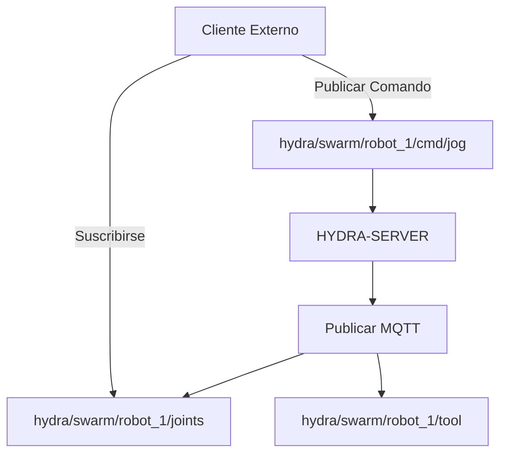

<!-- =============================================================================
HYDRA-UMC-MQTT-BROKER - MQTT broker for telemetry and integrations
Copyright (C) JuanenRac (Electro Hobby 3D) <electrohobby3d@gmail.com>
GPL-3.0-or-later - see LICENSE
============================================================================= -->

<p align="center">
  
</p>

# 📡 HYDRA-UMC-MQTT-BROKER

<p align="center"><a href="README.md">🇺🇸 English</a> | 🇪🇸 <b>Español</b> | <a href="README_fra.md">🇫🇷 Français</a> | <a href="README_ita.md">🇮🇹 Italiano</a> | <a href="README_deu.md">🇩🇪 Deutsch</a> | <a href="README_zho.md">🇨🇳 简体中文</a> | <a href="README_jpn.md">🇯🇵 日本語</a> | <a href="README_por.md">🇵🇹 Português</a></p>

### 🚀 Puente de Telemetría Ligero para IoT e Integraciones Externas

<p align="center">
  
  
  
  
  
  
</p>

---

**Comprobación de honestidad - qué funciona realmente hoy:** el transporte del broker (`src/server.ts`), la ACL de topics (`src/acl.ts`), y la autenticación CONNECT (`src/auth.ts`) son reales y están testeados (159 tests pasando en 12 archivos), y `tsc --noEmit` está limpio. No son tests unitarios aislados contra internos simulados - `tests/server.test.ts` conecta una librería cliente `mqtt` real sobre un socket TCP real contra un broker Aedes real en ejecución, y así fue como se encontró un bug real (el paso `broker.listen()` de Aedes 1.x omitido, colgando silenciosamente cada CONNECT). El listener MQTT-sobre-WebSocket y el límite de tamaño de payload funcionan igual: reales, opcionales y testeados contra el broker. Lo que genuinamente no está construido: el descubrimiento mDNS/Home Assistant solo está planeado - `server.ts` es un listener TCP plano sin ningún servicio de descubrimiento - y la forma de topic `hydra/swarm/...` del diagrama de abajo es la forma futura pretendida una vez que el propio estado de HYDRA-UMC-SERVER se puentee a MQTT, lo cual todavía no ha ocurrido; solo los topics `hydra/bridges/<name>/...` de los 5 puentes de máquina externos son reales y están cableados hoy. Ver `CHANGELOG.md` para lo que se ha entregado exactamente hasta ahora.

---

> **Estado de seguridad física y de ciberseguridad:** este ecosistema no es un sistema de seguridad certificado. Todavía no existe una ruta de E-STOP por hardware, ni límites ni enclavamientos aplicados por el firmware, ni un comando de movimiento verificado; las imágenes de firmware se comprueban con CRC-32 y una firma Ed25519, y una compilación de versión rechaza las claves de desarrollo publicadas (los cabezales de herramienta y las placas de expansión detrás del relé siguen con cargadores de URTC, que usan un HMAC-SHA256 de clave compartida en lugar de una firma); TLS y TLS mutuo son opcionales y están desactivados por defecto; aún no se ha poblado ni probado ninguna placa propia. Lee la [línea base de seguridad](https://github.com/JuanenRac/HYDRA-UMC-DOCS/blob/main/docs/SECURITY_BASELINE.md) y el [modelo de amenazas](https://github.com/JuanenRac/HYDRA-UMC-DOCS/blob/main/docs/THREAT_MODEL.md) antes de fiarte de cualquier afirmación de aquí para la seguridad de una persona.

---

## 📋 De un vistazo

| | |
|---|---|
| Versión | `0.1.7` |
| Madurez | Funcional |
| Tests | 159 (`npm test`) |
| Tecnología | Node.js / TypeScript / Aedes MQTT broker (MQTT 3.1.1) / MQTT over WebSockets (ws) / TLS and mutual TLS (optional) |
| Destino | La Raspberry Pi CM5 de una celda HYDRA-UMC |
| En hardware real | Todavía no: no consta ninguna ejecución en hardware real para esta versión |

**Ir a:** [Resumen](#-resumen) · [Arquitectura](#-arquitectura) · [Inicio rápido](#-inicio-rápido) · [Pruebas](#-pruebas) · [Estructura del repositorio](#-estructura-del-repositorio) · [Proyectos relacionados](#-proyectos-relacionados)

## 🚦 Estado del proyecto

Cada línea es una parte de este repositorio y la luz dice hasta dónde llega hoy. Se escribe con lo que el repositorio puede demostrar (pruebas, compilaciones, ejecuciones), no con lo previsto.

🟢 Hecho y verificado · 🟡 Funciona, con límites conocidos · 🟠 Hecho a medias o sin verificar · 🔴 Sin hacer o sin funcionar

| Área | Estado | Qué significa aquí |
|---|---|---|
| Software | 🟡 | Funciona para su propósito principal; la comprobación de honestidad de arriba lista lo que aún falta |
| Pruebas | 🟢 | 159 pruebas automáticas, ejecutadas en cada cambio |
| Hardware real | 🔴 | Todavía no: no consta ninguna ejecución en hardware real para esta versión |
| Documentación | 🟢 | README en ocho idiomas, comprobado contra el manifiesto en cada cambio |

## 🎯 Resumen

**HYDRA-UMC-MQTT-BROKER** proporciona una interfaz de mensajería asíncrona y ligera para el ecosistema HYDRA-UMC. Permite que dispositivos IoT externos, dashboards y sistemas de automatización del hogar (como Home Assistant) se suscriban a la telemetría del robot y publiquen comandos.

Implementa el estándar MQTT 3.1.1 (vía Aedes, verificado en vivo - ver Arquitectura más abajo), ofreciendo una distribución de datos de alta eficiencia con un overhead mínimo, lo que lo hace ideal para aplicaciones móviles o monitorización remota de bajo ancho de banda.

### Características Clave:
* 🔌 **Puentes de Máquinas Externas:** `HYDRA-UMC-BRIDGE-CNC`/`-LASER`/`-OPENPNP`/`-PRINTER3D`/`-ROS2` llegan cada uno a este broker por sus propios tópicos `hydra/bridges/<name>/...` - ver `docs/BRIDGE_TOPICS.md`. *(implementado)*
* 📡 **Telemetría Pub/Sub:** Distribución en menos de un milisegundo de ángulos de articulación, estados de herramienta y salud del sistema. *(planificado - el estado de los robots aún no pasa por el broker; hoy solo los topics `hydra/bridges/<name>/...` de los puentes de máquina)*
* 🛠️ **Soporte de Descubrimiento:** mDNS y auto-descubrimiento de Home Assistant para una configuración fácil. *(planeado - aún no implementado; `src/server.ts` es hoy un simple listener TCP, sin ningún servicio de descubrimiento)*
* 🔐 **Seguridad de Tópicos:** ACL real y verificable por prefijo de ID de cliente para leer y escribir en tópicos de robots específicos - un SUBSCRIBE con comodín nunca puede otorgar un acceso más amplio que su regla. *(implementado)*
* 🪪 **Autenticación de cliente:** La autenticación MQTT real y opcional de usuario/contraseña durante CONNECT (`MQTT_AUTH_JSON`) da a la ACL una identidad de sesión verificada - el propio `clientIdPrefix` requerido de cada credencial también se hace cumplir, de modo que una credencial válida pero de menor privilegio no puede simplemente elegir un ID de cliente distinto y más privilegiado para heredar sus permisos de ACL. *(implementada; usar junto con ACL)*
* 📏 **Límite de Tamaño de Payload:** Un límite real y opcional sobre el tamaño del payload de PUBLISH, configurable mediante `MAX_PAYLOAD_BYTES`. *(implementado)*
* ⚡ **Soporte de Websockets:** MQTT-sobre-WebSockets para clientes basados en navegador - el mismo broker, un segundo listener real y opcional junto al TCP plano existente (opción `wsPort` / variable de entorno `MQTT_WS_PORT`, puerto por defecto 8083). *(implementado)*
* ⏳ **Caducidad de mensajes retenidos:** Un TTL real y opcional para mensajes retenidos (opción `retainedTtlMs` / variable de entorno `MQTT_RETAINED_TTL_MS`) - un estado retenido más antiguo que el límite se borra activamente en vez de entregarse para siempre a cada futuro suscriptor. *(implementado)*
* 🛡️ **Política de producción:** Un arranque en producción (`NODE_ENV=production`, que fija el Dockerfile) se niega a funcionar sin `MQTT_AUTH_JSON` y `MQTT_ACL_JSON`, con contraseñas de al menos 16 caracteres que no sean de ejemplo y con una regla de ACL que cubra el prefijo de cada credencial; `MQTT_ALLOW_ANONYMOUS=1` dice a propósito que es un broker abierto de laboratorio. La ACL se evalúa contra la identidad que probó la credencial (su propio `clientIdPrefix`), no contra el client ID que eligió el cliente; los mensajes retenidos caducan a las 24 horas salvo que `MQTT_RETAINED_TTL_MS` diga otra cosa; `MQTT_BIND_HOST` / `MQTT_METRICS_HOST` eligen la interfaz en la que escuchan los listeners. *(implementado)*
* 🔐 **TLS fuera de loopback:** un arranque en producción se niega a ejecutarse cuando el listener MQTT en claro está abierto más allá de esta máquina (el valor por defecto es todas las interfaces) y TLS no está configurado; enlazar a `127.0.0.1` con `MQTT_BIND_HOST`, configurar TLS o aceptar a propósito una red de confianza con `MQTT_ALLOW_PLAINTEXT=1`. Cada arranque avisa de un listener en claro fuera de loopback. *(implementado)*
* 🔒 **TLS:** MQTT sobre TLS real y opcional (`MQTT_TLS_CERT` / `MQTT_TLS_KEY`, puerto 8883, más WebSocket seguro con `MQTT_WSS_PORT`) y TLS mutuo opcional (`MQTT_TLS_CA` con `MQTT_TLS_REQUIRE_CLIENT_CERT=1`). *(implementado)*
* 🧰 **Contraseñas con hash, identidad por certificado y límites para clientes lentos (todo opcional):** una contraseña de `MQTT_AUTH_JSON` puede guardarse como `scrypt$...` (se escribe con `npm run hash-password`; las contraseñas en claro siguen funcionando y el hash se calcula fuera del bucle de eventos); `MQTT_TLS_CERT_IDENTITY=1` (con TLS mutuo) identifica a un cliente por el CN de su certificado verificado, que debe ser prefijo de su ID de cliente, y aplica la ACL de ese nombre sin contraseña; `MQTT_CONNECT_TIMEOUT_MS`, `MQTT_KEEPALIVE_LIMIT_SECONDS` y `MQTT_QUEUE_LIMIT` acotan cuánto tiempo y con qué voracidad puede comportarse una conexión antes de cerrarla. Todo desactivado por defecto. *(implementado)*
* 📊 **Métricas Prometheus:** Listener real y opcional de `GET /metrics` (opción `metricsPort` / variable `MQTT_METRICS_PORT`, puerto por defecto 9883) que informa de clientes conectados, mensajes recibidos, denegaciones de ACL y bytes de entrada/salida. *(implementado)*

## 🧩 Papel en HYDRA-UMC

**HYDRA-UMC-MQTT-BROKER** es el centro de mensajes del ecosistema: un broker MQTT 3.1.1 (Aedes) con autenticación opcional por cliente y ACL de topics, entre paneles, sistemas domóticos, los bridges de máquinas (`HYDRA-UMC-BRIDGE-*`) y `HYDRA-UMC-SERVER`. Enruta mensajes; la decisión de seguridad queda en el receptor.

## 🏛️ Arquitectura

<p align="center">
  
</p>

<details>
<summary>Versión en texto del diagrama (Mermaid)</summary>



</details>

### ESTRUCTURA DE TÓPICOS MQTT

**Nota de honestidad:** el esquema de tema `hydra/swarm/...` de arriba
ilustra la forma *prevista* una vez que el estado propio de
HYDRA-UMC-SERVER se conecte a MQTT - esa conexión aún no está hecha
(`src/server.ts` lo dice en su propio comentario de cabecera: "lands once
that wiring is defined"), así que hoy nada publica en `hydra/swarm/...`.
Los temas que sí son reales y están conectados hoy son el espacio de
nombres `hydra/bridges/<name>/...` de los 5 puentes de máquina externos
(ver `docs/BRIDGE_TOPICS.md`) y el propio esquema de temas VDA 5050 de
HYDRA-UMC-BRIDGE-AMR.

### ARQUITECTURA Y DECISIONES DE DISEÑO

* **Por qué es hermano, no un submódulo, de HYDRA-UMC-GATEWAY-INDUSTRIAL.** Cada adaptador de protocolo es un proceso desplegable/reiniciable por separado - un problema en el broker nunca tumba los adaptadores de OPC-UA o MTConnect que corren junto a él.
* **Por qué un broker MQTT real, en vez de solo un cliente publicando a uno externo.** Poseer el broker significa que el propio flujo de eventos de esta célula (cambios de estado de robot, alarmas) está disponible para cualquier suscriptor MQTT de la red de planta sin depender de que un broker externo, gestionado aparte, esté alcanzable.
* **Por qué `src/server.ts` es deliberadamente fino.** Aedes hace el trabajo real del protocolo MQTT (framing de CONNECT/PUBLISH/SUBSCRIBE, QoS, mensajes retenidos y de testamento); este archivo es solo el transporte TCP plano que Aedes necesita, el listener opcional de MQTT-sobre-WebSocket, el cableado de la ACL/auth/límite de payload, y el logging a nivel de proceso. `buildBroker()` se exporta para que los tests arranquen un broker real en un puerto efímero y conecten clientes MQTT reales contra él.
* **Cómo encaja en el resto del ecosistema.** Un servicio hermano bajo HYDRA-UMC-GATEWAY-INDUSTRIAL - conecta el propio flujo de eventos de HYDRA-UMC-SERVER con temas MQTT reales.
* **Aquí se encontró y arregló un bug real: el broker nunca aceptaba clientes de verdad.** Aedes 1.x movió la configuración de persistencia/mqemitter a un paso async explícito `broker.listen()` (un cambio real de API respecto a la forma de fábrica de la 0.x); sin él, un `CONNECT` real llegaba al broker por un socket TCP real pero se colgaba en silencio hasta que el propio timeout de connack del cliente saltaba - el broker parecía "arriba" (el puerto aceptaba conexiones) pero ningún cliente podía completar una sesión jamás. Encontrado con un cliente `mqtt` real haciendo timeout en los propios tests de este proyecto, no por inspección. `tests/server.test.ts` ahora conecta una librería de cliente MQTT real contra un broker real por un socket real - CONNECT, entrega de PUBLISH, aislamiento de temas y mensajes retenidos, todo probado de verdad.
* **Por qué la ACL de tópicos comprueba el *alcance* de la suscripción, no solo el solapamiento del filtro.** La propia solicitud SUBSCRIBE de un cliente es en sí misma un filtro y puede llevar comodines `+`/`#` - comprobar ingenuamente si "el filtro solicitado se solapa con el permitido" dejaría que un cliente se suscribiera con un comodín más amplio (p. ej. `hydra/robots/#`) del que su regla realmente concede (p. ej. `hydra/robots/+/status`) y viera en silencio tópicos para los que nunca estuvo autorizado. `src/acl.ts`, con su función `isSubscriptionWithinScope()`, hace en su lugar una comprobación real, segmento por segmento - demostrado con tests reales, incluyendo uno en el que el propio intento de un robot de escalar su alcance con un SUBSCRIBE de comodín es denegado.
* **Por qué un PUBLISH denegado cierra toda la conexión, en vez de solo hacer NACK a un mensaje.** Este es el comportamiento real propio de Aedes (verificado ejecutando un cliente real contra él, no asumido de la documentación) - `authorizePublish` al devolver un error destruye la conexión del cliente. El diseño de la ACL/límite de payload aquí trabaja con eso, no en contra: un cliente que sigue siendo desconectado por violar su ACL es una señal clara y evidente para corregir la configuración de ese dispositivo, no un mensaje silenciosamente descartado que quizá nunca note.
* **Por qué la configuración de la ACL/límite de payload vive en variables de entorno (`MQTT_ACL_JSON`/`MAX_PAYLOAD_BYTES`), no en un archivo de configuración.** Coincide con la convención existente de `PORT` en este proyecto (ver `.env.example`) y con cómo se despliega realmente (entorno systemd/Docker, no un archivo montado) - `parseAclConfig()` falla el arranque de forma ruidosa ante un JSON malformado en vez de ejecutarse en silencio sin protección.
* **Por qué este broker habla MQTT 3.1.1, no MQTT v5.** `aedes@1.1.1` (la dependencia fijada) solo implementa MQTT 3.1/3.1.1 - verificado en vivo conectando un cliente `mqtt` real con `protocolVersion: 5`, que el broker rechaza activamente (`Connection refused: Unacceptable protocol version`), y confirmado contra la propia documentación upstream de Aedes (el soporte de MQTT 5.0 vive en una rama separada, no publicada). Todos los clientes de este ecosistema (los bridges `mqtt_transport.py`, `Vda5050Publisher`, los propios tests de este repo) ya negocian solo 3.1.1, así que esto es una corrección de documentación, no un cambio de comportamiento.

## 🚀 Inicio rápido

Requiere Node.js 20 o superior con npm.

```bash
npm install
npm test
npm run build
npm start
```

## 🧪 Pruebas

159 pruebas automáticas se ejecutan con `npm test`. No necesitan hardware ni nada fuera de esta máquina.

El CI ejecuta `HYDRA_UMC_CI=1 python tools/ci_validate.py`, que comprueba el manifiesto, los documentos, los ocho README y las imágenes.

## 🏗️ Compilación y publicación

### Requisitos
- [Node.js](https://nodejs.org/) (v18 o superior recomendado)
- npm

### Instalación
```bash
npm install
```

### Modo Desarrollo
Ejecuta el broker directamente con `tsx` (sin bundler):
- **Windows:** doble clic en `dev.bat` o ejecutar `npm run dev`
- **Linux/Mac:** ejecutar `./dev.sh` o `npm run dev`

### Build de Producción
Empaqueta el broker en un único archivo desplegable con esbuild:
- **Windows:** doble clic en `build.bat` o ejecutar `npm run build`
- **Linux/Mac:** ejecutar `./build.sh` o `npm run build`

Luego arráncalo con:
```bash
npm start
```

El broker escucha en `0.0.0.0:1883` (MQTT/TCP plano, el puerto por defecto
registrado en IANA) - apunta cualquier cliente MQTT (`mosquitto_sub`, Home
Assistant, MQTT Explorer, ...) a `<host>:1883`.

### Versionado
`npm run build` solo empaqueta el servidor y nunca cambia la versión; `python tools/hydra_project_tool.py bump` la sube (mediante `bump_manifest_version.py`) - un "cuentakilómetros" en base 10: patch +1 por bump, con
acarreo a minor (y de minor a major) al pasar de 9 en vez de llegar nunca
a un segmento de dos dígitos (`0.0.9` -> `0.1.0`, no `0.0.10`).

## 📂 Estructura del repositorio

<p align="center">
  
</p>

<details>
<summary>Versión en texto del árbol</summary>

```text
HYDRA-UMC-MQTT-BROKER/
├── src/                       Código fuente (Node/TypeScript - Broker, Puente, Seguridad)
├── tests/                     Suite Vitest - ACL, autenticación y comportamiento de broker/puente
├── docs/                      Documentación y catálogo de tópicos
├── images/                    Medios y diagramas
├── scripts/                   Scripts de utilidad (bump-version.mjs)
├── tools/                     ci_validate.py - validación de manifest/CHANGELOG/docs usada por la CI
├── .github/                   flujo de CI y plantillas de incidencias
├── CHANGELOG.md               qué cambió en cada versión
├── Dockerfile                 imagen de contenedor
├── build-test.sh              comprobación de compilación sin cambios
├── build.sh                   compila y comprueba; nunca cambia la versión
├── bump_manifest_version.py   sincroniza la versión del manifiesto
├── dev.sh                     modo de desarrollo
├── hydra-umc.project.json     manifiesto: versión, madurez, familia
├── package.json               metadatos y scripts del paquete
└── test.sh                    ejecuta las pruebas
```

</details>

## 🗺️ Hoja de ruta y límites conocidos

**Límites conocidos hoy**

* **Fase 1:** Implementación de OPC-UA Pub/Sub para intercambio de datos de alta velocidad y puente de protocolos heredados.
* **Fase 2:** Clúster de Broker MQTT para gestión masiva de dispositivos IoT y alta concurrencia.
* **Fase 3:** Soporte del adaptador MTConnect para integración de maquinaria CNC y PLC multi-vendedor.
* **Fase 4:** Soporte para la especificación Sparkplug B para alineación con IoT industrial y puente de telemetría unificado.

## 🌍 Idiomas

Este README y los documentos del repositorio existen en ocho idiomas: inglés, español, alemán, francés, italiano, japonés, chino y portugués (Portugal). Se escriben a la vez y el CI comprueba que los ocho ficheros tengan las mismas secciones y los mismos enlaces. Este repositorio no tiene pantalla ni catálogo de mensajes propios, así que no hay cadenas de interfaz que traducir.

## 🔗 Proyectos relacionados

Este proyecto es parte del ecosistema de robótica HYDRA-UMC del mismo autor (JuanenRac / Electro Hobby 3D). Vale la pena conocerlo, ya que una petición podría en realidad ser sobre alguno de estos en vez de sobre este repositorio.

**Proyecto Padre**
- **[HYDRA-UMC-GATEWAY-INDUSTRIAL](https://github.com/JuanenRac/HYDRA-UMC-GATEWAY-INDUSTRIAL)** — nodo de integración que retransmite a protocolos industriales, con una capa real de lista blanca de comandos/contrapresión; el padre del que este repositorio es un adaptador de protocolo específico, dentro de su propia pasarela industrial.

**Proyectos Hermanos** — los demás adaptadores de protocolo de la propia pasarela industrial de HYDRA-UMC-GATEWAY-INDUSTRIAL
- **[HYDRA-UMC-OPCUA-SERVER](https://github.com/JuanenRac/HYDRA-UMC-OPCUA-SERVER)** — espacio de direcciones OPC-UA real, verificado con una sesión de cliente real del protocolo binario.
- **[HYDRA-UMC-MTCONNECT-ADAPTER](https://github.com/JuanenRac/HYDRA-UMC-MTCONNECT-ADAPTER)** — endpoints XML reales `/probe` y `/current` de MTConnect, con salida en modo degradado.

**Directamente Relacionados**
- **[HYDRA-UMC-SERVER](https://github.com/JuanenRac/HYDRA-UMC-SERVER)** — el backend headless real (REST/WebSocket) con el que habla de verdad cada cliente de control — la fuente del estado que expone este adaptador.
- **[HYDRA-UMC-BRIDGE-CNC](https://github.com/JuanenRac/HYDRA-UMC-BRIDGE-CNC)** — coordinador de alto nivel para celdas CNC con acceso a estado/bytes de control GRBL (probado solo contra un emulador) — incluye su propio `mqtt_transport.py` que alcanza este broker a través de sus propios tópicos `hydra/bridges/<nombre>/...`; ver el propio `docs/BRIDGE_TOPICS.md` de este repositorio para el catálogo de tópicos real y compartido.
- **[HYDRA-UMC-BRIDGE-LASER](https://github.com/JuanenRac/HYDRA-UMC-BRIDGE-LASER)** — coordinador de celdas láser que lee 3 señales GPIO de llave/carcasa/enclavamiento (probado solo contra un chip simulado; no puede armar ni disparar un láser) — incluye su propio `mqtt_transport.py` que alcanza este broker a través de sus propios tópicos `hydra/bridges/<nombre>/...`; ver el propio `docs/BRIDGE_TOPICS.md` de este repositorio para el catálogo de tópicos real y compartido.
- **[HYDRA-UMC-BRIDGE-OPENPNP](https://github.com/JuanenRac/HYDRA-UMC-BRIDGE-OPENPNP)** — coordinador de alto nivel seguro para el flujo de placas de pick-and-place OpenPnP — incluye su propio `mqtt_transport.py` que alcanza este broker a través de sus propios tópicos `hydra/bridges/<nombre>/...`; ver el propio `docs/BRIDGE_TOPICS.md` de este repositorio para el catálogo de tópicos real y compartido.
- **[HYDRA-UMC-BRIDGE-PRINTER3D](https://github.com/JuanenRac/HYDRA-UMC-BRIDGE-PRINTER3D)** — barrera de coordinación segura para impresoras 3D Moonraker/Klipper, con comandos de trabajo reales y controlados — incluye su propio `mqtt_transport.py` que alcanza este broker a través de sus propios tópicos `hydra/bridges/<nombre>/...`; ver el propio `docs/BRIDGE_TOPICS.md` de este repositorio para el catálogo de tópicos real y compartido.
- **[HYDRA-UMC-BRIDGE-ROS2](https://github.com/JuanenRac/HYDRA-UMC-BRIDGE-ROS2)** — coordinador con un transporte ROS 2 rclpy importado de forma perezosa (todavía no ejecutado contra una instalación de ROS 2) — incluye su propio `mqtt_transport.py` que alcanza este broker a través de sus propios tópicos `hydra/bridges/<nombre>/...`; ver el propio `docs/BRIDGE_TOPICS.md` de este repositorio para el catálogo de tópicos real y compartido.
- **[HYDRA-UMC-BRIDGE-AMR](https://github.com/JuanenRac/HYDRA-UMC-BRIDGE-AMR)** — barrera de coordinación para flotas AGV/AMR mediante un publicador MQTT VDA 5050 (probado solo contra una flota emulada) — un cliente real distinto de este mismo broker: `Vda5050Publisher` envía despachos ya validados como mensajes VDA 5050 `order`/`instantActions` reales, con la forma de tópico propia de VDA 5050 en vez del esquema `hydra/bridges/...` que usan los demás bridges.

**También Forma Parte del Ecosistema**

*Hardware y Plataforma Base*
- **[HYDRA-UMC](https://github.com/JuanenRac/HYDRA-UMC)** — el diseño de la placa madre del brazo robótico: host CM5 + coprocesador STM32H745 de doble núcleo, pensado para coordinar hasta 8 brazos herramienta por CAN-OTA/SPI-OTA (firmware en fase temprana; todavía no hay ninguna placa poblada).
- **[HYDRA-UMC-OS](https://github.com/JuanenRac/HYDRA-UMC-OS)** — capa de producto reproducible sobre Raspberry Pi OS para el CM5: agente de solo lectura, config/perfiles validados, aprovisionamiento WiFi de primer contacto.
- **[HYDRA-UMC-SDK](https://github.com/JuanenRac/HYDRA-UMC-SDK)** — el contrato JSON-Schema compartido y la barrera de software de puerta de trabajos contra la que cada bridge valida sus comandos (no es una función de seguridad certificada).
- **[HYDRA-UMC-CONNECTOR-HUB](https://github.com/JuanenRac/HYDRA-UMC-CONNECTOR-HUB)** — registro declarativo y validador de manifiestos de adaptador para conectores de máquinas externas; extiende la propia idea de contrato del SDK a máquinas externas sin sustituir a los proyectos de pasarela industrial.

*Backend Central y Clientes*
- **[HYDRA-UMC-STUDIO](https://github.com/JuanenRac/HYDRA-UMC-STUDIO)** — panel de control web con visualización 3D multi-robot en tiempo real.
- **[HYDRA-UMC-SUITE](https://github.com/JuanenRac/HYDRA-UMC-SUITE)** — centro de mando de enjambre de escritorio (PySide6) para varios servidores a la vez, empaquetado como ejecutable independiente.
- **[HYDRA-UMC-ANDROID-CONTROL](https://github.com/JuanenRac/HYDRA-UMC-ANDROID-CONTROL)** — app nativa de control para Android con inicio de sesión biométrico y un compañero Wear OS emparejado.
- **[HYDRA-UMC-IOS-CONTROL](https://github.com/JuanenRac/HYDRA-UMC-IOS-CONTROL)** — app de control para iOS/iPadOS (Flutter) con sincronización en tiempo real por WebSocket.
- **[HYDRA-UMC-DSI](https://github.com/JuanenRac/HYDRA-UMC-DSI)** — interfaz táctil nativa para la pantalla táctil DSI de 7" a bordo, embebida en el propio CM5.
- **[HYDRA-UMC-EDITOR-URDF](https://github.com/JuanenRac/HYDRA-UMC-EDITOR-URDF)** — creador/editor gráfico de URDF de escritorio que envía los modelos terminados al propio catálogo de STUDIO.
- **[HYDRA-UMC-EDITOR-STL](https://github.com/JuanenRac/HYDRA-UMC-EDITOR-STL)** — editor de escritorio de modelos STL, que transforma/reemplaza/quita/añade piezas reales en el mismo catálogo de modelos que también edita HYDRA-UMC-EDITOR-URDF.
- **[HYDRA-UMC-BRIDGE-DROIDS](https://github.com/JuanenRac/HYDRA-UMC-BRIDGE-DROIDS)** — barrera de coordinación para droides con patas/humanoides, con un emisor de comandos para Boston Dynamics Spot (probado solo contra un emulador).
- **[HYDRA-UMC-BRIDGE-UAV](https://github.com/JuanenRac/HYDRA-UMC-BRIDGE-UAV)** — barrera de coordinación para UAV equipados con cámara, con un emisor de comandos MAVLink (probado solo contra un emulador).

*Plataforma de Herramientas URTC*
- **[URTC](https://github.com/JuanenRac/URTC)** — firmware para la placa física del Universal Robot Tool Controller, más de 25 perfiles de herramienta por bus CAN.
- **[URTC-FLASHER](https://github.com/JuanenRac/URTC-FLASHER)** — herramienta de escritorio con GUI para flashear placas URTC, CAN-OTA más SWD/JTAG de chip completo.
- **[URTC-TESTER](https://github.com/JuanenRac/URTC-TESTER)** — herramienta de escritorio de diagnóstico CAN-bus en vivo para placas URTC, un panel por perfil de herramienta.
- **[URTC-WEB-STUDIO](https://github.com/JuanenRac/URTC-WEB-STUDIO)** — alternativa basada en navegador a URTC-TESTER mediante la Web Serial API, sin instalación local.
- **[URTC-GATEWAY](https://github.com/JuanenRac/URTC-GATEWAY)** — pasarela delante del bus CAN de URTC: lista de identificadores permitidos, límite de tasa y clave de sesión; software probado en ordenador, aún no en un bus real.

*Nodo IA de Visión (Hailo-8)*
- **[HYDRA-UMC-VISION-NODE](https://github.com/JuanenRac/HYDRA-UMC-VISION-NODE)** — nodo de integración para el pipeline de visión Hailo-8, con una comprobación real de disponibilidad de hardware por etapa.
- **[HYDRA-UMC-DETECTION-HEF](https://github.com/JuanenRac/HYDRA-UMC-DETECTION-HEF)** — registro real de modelos compilados con verificación de carga segura por arquitectura Hailo/checksum.
- **[HYDRA-UMC-VISION-STREAMER](https://github.com/JuanenRac/HYDRA-UMC-VISION-STREAMER)** — generador real de pipeline GStreamer + config MediaMTX, con una frontera de integración HailoRT real.
- **[HYDRA-UMC-VISUAL-SERVOING-API](https://github.com/JuanenRac/HYDRA-UMC-VISUAL-SERVOING-API)** — ley de corrección Position-Based Visual Servoing con autorización condicionada al estado de zona; todavía sin estimación de pose por cámara.
- **[HYDRA-UMC-SAFETY-ZONES](https://github.com/JuanenRac/HYDRA-UMC-SAFETY-ZONES)** — lógica v0 de invasión de zona, vigencia de calibración y solicitud de E-STOP que toma las posiciones de los objetos de un fichero; ningún detector la alimenta y todavía no hay un E-STOP físico conectado.

*Nodo IA Cognitivo (Hailo-10)*
- **[HYDRA-UMC-COGNITIVE-NODE](https://github.com/JuanenRac/HYDRA-UMC-COGNITIVE-NODE)** — nodo de integración para el pipeline cognitivo Hailo-10 (orquestación de LLM/VLA/voz).
- **[HYDRA-UMC-VLA-ENGINE](https://github.com/JuanenRac/HYDRA-UMC-VLA-ENGINE)** — codificación/decodificación real de tokens de acción y generación de trayectoria para un modelo Vision-Language-Action.
- **[HYDRA-UMC-VOICE-UI](https://github.com/JuanenRac/HYDRA-UMC-VOICE-UI)** — front-end de voz real (VAD + analizador de intención) con un relé a Watch acotado y con confirmación.
- **[HYDRA-UMC-SEMANTIC-PLANNER](https://github.com/JuanenRac/HYDRA-UMC-SEMANTIC-PLANNER)** — descomposición real de tareas basada en reglas y recuperación semántica de errores sobre códigos de error del MCU.
- **[HYDRA-UMC-DOCS-QA](https://github.com/JuanenRac/HYDRA-UMC-DOCS-QA)** — búsqueda real de documentos TF-IDF (solo librería estándar) sobre los propios documentos Markdown de este ecosistema.
- **[HYDRA-UMC-LOCAL-TECHNICIAN](https://github.com/JuanenRac/HYDRA-UMC-LOCAL-TECHNICIAN)** — técnico de mantenimiento con IA local y con puertas de política para el propio ecosistema - observa, diagnostica y propone arreglos; los dos niveles de riesgo más altos están deliberadamente sin implementar todavía.

*Orquestación y Enjambre*
- **[HYDRA-UMC-ORCHESTRATOR](https://github.com/JuanenRac/HYDRA-UMC-ORCHESTRATOR)** — nodo de integración con un contrato real de informe de salud gRPC/Protobuf y una máquina de estados de misión.
- **[HYDRA-UMC-JOB-DISPATCHER](https://github.com/JuanenRac/HYDRA-UMC-JOB-DISPATCHER)** — cola de trabajos real basada en prioridad con deduplicación, sobre una API HTTP real.
- **[HYDRA-UMC-NODE-HEALING](https://github.com/JuanenRac/HYDRA-UMC-NODE-HEALING)** — watchdog de salud de flota real basado en gRPC, con reintento/backoff y detección de discrepancia de identidad.
- **[HYDRA-UMC-PATH-PLANNER-3D](https://github.com/JuanenRac/HYDRA-UMC-PATH-PLANNER-3D)** — planificador de rutas 3D real basado en RRT, con validación real de colisión de obstáculos/espacio de trabajo.
- **[HYDRA-UMC-SWARM-SYNC](https://github.com/JuanenRac/HYDRA-UMC-SWARM-SYNC)** — sincronización de estado real mediante CRDT LWW-Element-Map, con pruebas de propiedades para convergencia multi-celda.

*Gemelo Digital y Simulación*
- **[HYDRA-UMC-TWIN](https://github.com/JuanenRac/HYDRA-UMC-TWIN)** — nodo de integración para el motor de gemelo digital, con un contrato real de sincronización por compatibilidad de versión.
- **[HYDRA-UMC-HIL-BRIDGE](https://github.com/JuanenRac/HYDRA-UMC-HIL-BRIDGE)** — enrutador hardware-in-the-loop con un enclavamiento de software por colisión entre simulación y hardware real (probado sin hardware real).
- **[HYDRA-UMC-PHYSICS-REPLICA](https://github.com/JuanenRac/HYDRA-UMC-PHYSICS-REPLICA)** — cinemática directa real y validación de límites articulares sobre un subconjunto real de URDF.
- **[HYDRA-UMC-SYNTHETIC-DATA-GEN](https://github.com/JuanenRac/HYDRA-UMC-SYNTHETIC-DATA-GEN)** — generador real de escenas 2D procedurales con exportación de anotaciones YOLO/COCO.

*Datos y Analítica*
- **[HYDRA-UMC-DATALAKE](https://github.com/JuanenRac/HYDRA-UMC-DATALAKE)** — almacén de series temporales real respaldado por sqlite3, con una API HTTP real de ingesta/consulta.
- **[HYDRA-UMC-ANOMALY-DETECTOR](https://github.com/JuanenRac/HYDRA-UMC-ANOMALY-DETECTOR)** — detector de anomalías real basado en FFT + línea base estadística, con monitorización de deriva.
- **[HYDRA-UMC-PRODUCTION-REPORTS](https://github.com/JuanenRac/HYDRA-UMC-PRODUCTION-REPORTS)** — cálculo real de OEE/disponibilidad sobre el histórico de DATALAKE, con exportación CSV reproducible.
- **[HYDRA-UMC-TELEMETRY-COLLECTOR](https://github.com/JuanenRac/HYDRA-UMC-TELEMETRY-COLLECTOR)** — pipeline real de ingesta CAN/WebSocket hacia DATALAKE, con deduplicación por secuencia.

*Herramientas Complementarias y Operaciones del Ecosistema*
- **[HYDRA-UMC-DASHBOARD-AI](https://github.com/JuanenRac/HYDRA-UMC-DASHBOARD-AI)** — paneles de Resúmenes Inteligentes y Resaltado de Anomalías sobre DATALAKE/ANOMALY-DETECTOR, con un respaldo estadístico honesto.
- **[HYDRA-UMC-TOOL-CLI](https://github.com/JuanenRac/HYDRA-UMC-TOOL-CLI)** — CLI de flota con un contrato real y estable de códigos de salida, cliente real y en vivo de la propia API de HYDRA-UMC-SERVER.
- **[HYDRA-UMC-WATCH](https://github.com/JuanenRac/HYDRA-UMC-WATCH)** — app compañera de WearOS con patrones de alerta háptica y un relé de voz al teléfono emparejado (todavía no ejecutada en un reloj físico).
- **[URTC-SMART-RACK](https://github.com/JuanenRac/URTC-SMART-RACK)** — firmware para un rack de montaje de placas con decodificación real de ID de herramienta y lógica de precalentamiento Smart Idle.
- **[URTC-VISION-TOOL](https://github.com/JuanenRac/URTC-VISION-TOOL)** — firmware más un compañero de visión real en Python para un cabezal de inspección térmica/RGB.
- **[HYDRA-UMC-UPDATER](https://github.com/JuanenRac/HYDRA-UMC-UPDATER)** — herramienta administrativa de escritorio que descubre, clona y actualiza cada repositorio de este ecosistema.
- **[HYDRA-UMC-OS-REBUILDER](https://github.com/JuanenRac/HYDRA-UMC-OS-REBUILDER)** — herramienta de escritorio Windows/Linux que construye una imagen de la CM5 lista para grabar, precargada con las versiones más actuales del ecosistema, con configuración de primer arranque de Wi-Fi/usuario/SSH al estilo de Raspberry Pi Imager.
- **[HYDRA-UMC-OPS-AGENT](https://github.com/JuanenRac/HYDRA-UMC-OPS-AGENT)** — coordinador de incidencias de mantenimiento: un rol edge de bajo privilegio recopila un snapshot de inventario/salud saneado, un rol control-plane lo renderiza de solo lectura y pide a un proveedor de IA que sugiera un diagnóstico - nunca aplica un parche ni despliega nada.
- **[HYDRA-UMC-DEV-SERVER](https://github.com/JuanenRac/HYDRA-UMC-DEV-SERVER)** — host de desarrollo reproducible (Raspberry Pi 5 / CM5) que almacena el código del ecosistema y ejecuta tareas acotadas de compilación/pruebas bajo una cola duradera; un rol de desarrollo dedicado, explícitamente distinto de un CM5 operativo.

## 📚 Documentación

Dónde leer más:

* **[docs/BRIDGE_TOPICS.md](docs/BRIDGE_TOPICS.md)** — el catálogo real y compartido de temas `hydra/bridges/<name>/...` que usa de verdad cada puente de máquina externo (CNC/Laser/OpenPnP/Printer3D/ROS2) contra este broker.
* [Base de seguridad del ecosistema](https://github.com/JuanenRac/HYDRA-UMC-DOCS/blob/main/docs/SECURITY_BASELINE.md)
* [Modelo de amenazas del ecosistema](https://github.com/JuanenRac/HYDRA-UMC-DOCS/blob/main/docs/THREAT_MODEL.md)
* [Historial de cambios de este repositorio](CHANGELOG.md)
* [Licencia de este repositorio](LICENSE.md)

## 🤝 Contribuir y comunidad

* Antes de un pull request ejecuta `HYDRA_UMC_CI=1 py -3 tools/ci_validate.py` (o `HYDRA_UMC_CI=1 python3 tools/ci_validate.py`): debe imprimir `CI_VALIDATION=PASS`. No ejecutes `build.sh` ni `build.bat` para esta comprobación; compilar no es comprobar.
* Los ocho README se escriben desde una sola fuente en HYDRA-UMC-DOCS; no los edites a mano. Cambia la fuente y vuelve a escribirlos con `tools/make_readmes.py`.
* No afirmes en un README lo que no se ha ejecutado: di «simulado» o «sin probar en hardware» cuando esa sea la verdad.
* Mira [CONTRIBUTING.md](CONTRIBUTING.md), el [código de conducta](CODE_OF_CONDUCT.md), [SECURITY.md](SECURITY.md) y [SUPPORT.md](SUPPORT.md).

## 👤 AUTOR

**JuanenRac (Electro Hobby 3D)** · electrohobby3d@gmail.com

## 📜 LICENCIA

GPL-3.0-or-later - [LICENSE](LICENSE).
